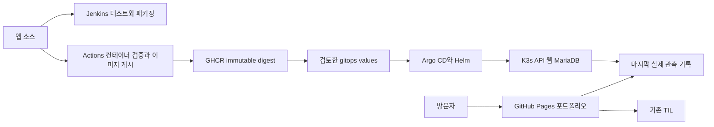

# DevDooly Platform Lab

Java 서비스 개발부터 데이터 처리, 배포와 운영까지 직접 구현하고 결과를 공개하는 개인 플랫폼 프로젝트입니다. 직접 만든 합성 센서 데이터로 처리 규칙과 오류 대응을 재현하고, [TIL](https://devdooly.github.io/TIL/)에 설계와 문제 해결 기록을 연결합니다.

[포트폴리오](https://devdooly.github.io/devdooly-platform-lab/) · [GitHub](https://github.com/DevDooly/devdooly-platform-lab) · [시작 안내](docs/START_HERE.md) · [진행 목록](docs/ROADMAP.md) · [다음 개발 계획](docs/NEXT_STEPS.md)

## 현재 구현과 검증

| 영역 | 확인한 결과 | 근거 |
| --- | --- | --- |
| Java 21·Spring Boot | 데이터 검증·조회, JPA·Flyway, 테스트 15개 | [API 계약](docs/contracts/demo-api.md), [API 검증](docs/evidence/api-mvp/README.md) |
| Astro·React | 결과·실패 필터·차트, 테스트 13개, 실제 관측 기록 fallback | [화면 검증](apps/lab-web/VALIDATION.md), [관측 계약](apps/lab-web/OBSERVATION.md) |
| GitHub Actions·GHCR | Linux 컨테이너 통합 검증 후 immutable digest 이미지 게시 | [컨테이너 근거](docs/evidence/compose-ci/README.md), [이미지 게시](docs/runbooks/image-publication.md) |
| K3s·Helm·Argo CD | 미니 PC에서 앱 자동 동기화, Synced·Healthy, MariaDB PVC | [실제 서버 근거](docs/evidence/mini-pc/README.md), [GitOps 선언](gitops/README.md) |
| Jenkins | Kubernetes agent에서 실제 테스트·패키징 | [빌드 근거와 한계](docs/evidence/jenkins-ci/README.md), [CI 절차](docs/runbooks/jenkins-ci.md) |
| 관리자 접속 | ClusterIP 관리 화면과 SSH 접속 도우미 | [접속 방법](docs/runbooks/admin-access.md) |
| 백업과 복구 | 외부 암호화 백업·격리 DB 복원·호스트 재부팅 | [실제 검증과 한계](docs/evidence/recovery/README.md) |

미니 PC의 웹을 통해 API·MariaDB를 조회하고 합성 입력 12건의 결과를 확인했습니다. 기대 결과는 성공 7·실패 3·중복 2·대기 0입니다. 공개 Pages는 **미니 PC에서 확인한 마지막 기록**과 수집 시각·source commit을 표시합니다. 현재 공개 홈에 미니 PC 실시간 API는 연결하지 않았습니다.

API의 Jenkins·Argo CD·Kubernetes `NOT_CONFIGURED`는 **상태 수집 연결 전**을 뜻합니다. 실제 설치·실행 결과는 근거 문서에서 확인하며, collector 연결 없이 API 상태를 정상으로 바꾸지 않습니다. releases는 현재 JVM 정보입니다.

## 로컬 실행

Java 21과 Node 24.19.0을 사용합니다. API와 화면을 별도 터미널에서 실행합니다.

```sh
cd apps/api
./mvnw -B -ntp verify
./mvnw spring-boot:run -Dspring-boot.run.profiles=local-dev
```

Windows에서는 `mvnw.cmd`를 사용합니다. 화면은 다음과 같습니다.

```sh
cd apps/lab-web
npm ci
npm run dev
```

화면은 `http://127.0.0.1:4321/`이며 `/api`를 로컬 API에 연결합니다. 전체 DB 구성은 [MariaDB·Compose 안내](docs/runbooks/local-compose.md)를 따릅니다. H2 로컬 검증, Linux MariaDB 통합 검증과 미니 PC K3s 검증은 각각 기록합니다.

## 배포 구조



현재 이미지 게시자는 GitHub Actions입니다. Jenkins는 테스트와 패키징을 실행하며, 이미지 게시·GitOps 변경 PR을 Jenkins에서 자동으로 수행하는 단계는 남아 있습니다. Argo CD가 앱의 배포를 관리합니다. 동일 앱에 Jenkins의 `helm upgrade`를 중복 적용하지 않습니다.

기존 Docker 서비스·프록시·방화벽은 보존했습니다. K3s 기본 Traefik·ServiceLB는 사용하지 않습니다. 외부 암호화 백업, 격리 DB 복원과 호스트 재부팅 복구를 검증했습니다. K3s·Jenkins archive 전체 복원과 이전 image digest 복구는 아직 검증하지 않았습니다. Kafka·S3는 4단계, AI 개선 재현은 5단계, Iceberg·Spark·Trino는 6단계입니다.

## 저장소 구성

```text
apps/api/                 Spring Boot, JPA·Flyway, 데이터·HTTP 테스트
apps/lab-web/             Astro·React 포트폴리오와 Lab 조회 화면
tests/scenarios/          합성 데이터의 독립 기대 결과
infra/containers/         API·웹 이미지와 Nginx 설정
infra/charts/             API·웹·MariaDB Helm chart
infra/jenkins/            Kubernetes CI agent 정의
infra/platform/           기반 도구의 버전과 설치 값
infra/scripts/            점검·bootstrap·관리 접속 도우미
gitops/                   Argo CD Application과 환경별 image digest
docs/                     계획, ADR, 계약, 운영·검증 근거
benchmarks/               후속 공개 예제의 전후 측정
```

회사 코드·데이터·실제 수율 알고리즘을 사용하지 않습니다. 실제 접속 주소·진단 원본·비밀값은 Git에서 제외한 `.local/`에 보관합니다. 공개 화면에는 허용한 요약만 제공합니다.
