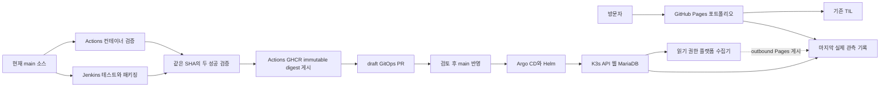

# DevDooly Platform Lab

Java 서비스 개발부터 데이터 처리, 배포와 운영까지 직접 구현하고 결과를 공개하는 개인 플랫폼 프로젝트입니다. 직접 만든 합성 센서 데이터로 처리 규칙과 오류 대응을 재현하고, [TIL](https://devdooly.github.io/TIL/)에 설계와 문제 해결 기록을 연결합니다.

[포트폴리오](https://devdooly.github.io/devdooly-platform-lab/) · [GitHub](https://github.com/DevDooly/devdooly-platform-lab) · [시작 안내](docs/START_HERE.md) · [진행 목록](docs/ROADMAP.md) · [다음 개발 계획](docs/NEXT_STEPS.md)

## 현재 구현과 검증

| 영역 | 확인한 결과 | 근거 |
| --- | --- | --- |
| Java 21·Spring Boot | 데이터 검증·조회, JPA·Flyway, 기존 배포본 테스트 15개 | [API 계약](docs/contracts/demo-api.md), [API 검증](docs/evidence/api-mvp/README.md) |
| Astro·React | 결과·실패 필터·차트, 테스트 13개, 실제 관측 기록 fallback | [화면 검증](apps/lab-web/VALIDATION.md), [관측 계약](apps/lab-web/OBSERVATION.md) |
| GitHub Actions·GHCR | Linux 컨테이너 통합 검증 후 immutable digest 이미지 게시 | [컨테이너 근거](docs/evidence/compose-ci/README.md), [이미지 게시](docs/runbooks/image-publication.md) |
| K3s·Helm·Argo CD | 미니 PC에서 앱 자동 동기화, Synced·Healthy, MariaDB PVC | [실제 서버 근거](docs/evidence/mini-pc/README.md), [GitOps 선언](gitops/README.md) |
| Jenkins·Actions 게시 gate | 같은 source SHA의 두 CI 성공 후 이미지·draft GitOps PR, 실제 테스트 실패 차단 | [연결 검증](docs/evidence/cicd-gate/README.md), [CI 절차](docs/runbooks/cicd-publication.md) |
| 플랫폼 관측 수집 | 최소 읽기 수집·실패 보존·게시 순서 교정과 timer 자동 게시 11회 성공 | [수집 검증과 남은 범위](docs/evidence/platform-observation/README.md), [공개 필드 계약](apps/lab-web/PLATFORM_OBSERVATION.md) |
| 관리자 접속 | ClusterIP 관리 화면과 SSH 접속 도우미 | [접속 방법](docs/runbooks/admin-access.md) |
| 백업과 복구 | 외부 암호화 백업·격리 DB 복원·호스트 재부팅 | [실제 검증과 한계](docs/evidence/recovery/README.md) |

미니 PC의 웹을 통해 API·MariaDB를 조회하고 합성 입력 12건의 결과를 확인했습니다. 기대 결과는 성공 7·실패 3·중복 2·대기 0입니다. 공개 Pages는 **미니 PC에서 확인한 마지막 기록**과 수집 시각·source commit을 표시합니다. 현재 공개 홈에 미니 PC 실시간 API는 연결하지 않았습니다.

API의 Jenkins·Argo CD·Kubernetes `NOT_CONFIGURED`는 **조회 API 내부의 상태 수집 연결 전**을 뜻합니다. 별도의 정적 플랫폼 collector는 실제 서버 수집과 인증 실패 후 이전 성공 기록·수집 시각 보존 및 회복을 확인했습니다. 이 결과로 API 값을 정상으로 바꾸지 않으며, releases는 현재 JVM 정보입니다.

새 플랫폼 관측본은 Jenkins 대상 SHA·Argo GitOps revision·API 배포 선언 소스와 image digest를 구분합니다. 읽기 권한의 허용·거부와 출력 `0600`, 인증 실패 후 이전 성공 보존을 확인했습니다. 공개 화면은 1280px·390px에서 가로 넘침 없이 확인했습니다. 실제 게시 순서 역전에서 발견한 seed 회귀도 교정 후 재검증했습니다. **API·웹을 0개로 내린 동안에도 공개 홈·마지막 기록이 유지됐고 같은 정상 B로 복원했습니다. 전용 Pages 자격증명으로 수동 호스트 수집·실제 systemd service·timer 자동 실행과 Pages 게시를 확인했습니다. 최초 자동 실행을 포함한 11회의 Pages build·deploy가 모두 성공했고, 실제 서비스 완료 간격은 약 30분 26초~31분 15초였습니다.** timer는 enabled·active이며 자격증명 만료·회전과 장기간 운영은 아직 검증하지 않았습니다. [초기 공개 화면과 반복 실행의 근거](docs/evidence/platform-observation/README.md)를 구분해 기록합니다.

4단계의 DB 작업·outbox·단일 실행 슬롯을 구현하고 격리 MariaDB에서 검증했습니다. 기본 verify 35개와 V1 업그레이드·빈 DB 초기화·반복 시작 각각 17개가 통과했습니다. 현재는 검토용 브랜치이며 운영 image·DB와 공개 실행은 갱신하지 않았습니다. [DB 구현·보존 결과](docs/evidence/db-job-foundation/README.md)와 [내부 서비스 절차](docs/runbooks/db-job-foundation.md)를 연결합니다. 이후 Garage 원본 보관·전체 bytes/크기/SHA-256 검증을 추가했고 기본 verify 54개, 실제 SDK 4개와 컨테이너 재생성 전후 각 1개가 통과했습니다. 첫 SDK checksum 실패·교정과 기존 운영 보존은 [S3 검증 기록](docs/evidence/s3-source-storage/README.md), 선정 조건은 [ADR 0005](docs/adr/0005-verified-raw-source-storage.md)에 있습니다. Kafka·결과 export는 다음 작업입니다.

## 로컬 실행

Java 21과 Node 24.19.0을 사용합니다. API와 화면을 별도 터미널에서 실행합니다.

```sh
cd apps/api
./mvnw -B -ntp verify
./mvnw spring-boot:run -Dspring-boot.run.profiles=local-dev
```

Windows에서는 `mvnw.cmd`를 사용합니다. 화면은 다음과 같습니다.

```sh
cd apps/lab-web
npm ci
npm run dev
```

화면은 `http://127.0.0.1:4321/`이며 `/api`를 로컬 API에 연결합니다. 전체 DB 구성은 [MariaDB·Compose 안내](docs/runbooks/local-compose.md)를 따릅니다. H2 로컬 검증, Linux MariaDB 통합 검증과 미니 PC K3s 검증은 각각 기록합니다.

## 배포 구조



GitHub Actions가 유일한 이미지 게시자입니다. 현재 main의 같은 source SHA에서 Jenkins 테스트·필수 산출물과 Actions 통합 검증이 모두 성공해야 게시합니다. Jenkins는 전용 credential로 commit status만 전달합니다. Actions의 draft GitOps PR 자동 제안을 활성화했으며, 검토 후 main에 반영하면 Argo CD가 배포합니다. 자동 승인·자동 병합과 Jenkins의 `helm upgrade`는 사용하지 않습니다.

정상 B 배포에서 source SHA·image digest·GitOps commit·실행 이미지를 연결했습니다. 실제 JUnit 실패에서는 새 이미지·게시 artifact·GitOps PR이 생기지 않았고, 기존 B의 Deployment·Pod·전체 SQL·저장 시각·PVC와 기존 Docker 상태가 유지됐습니다. 이후 GitOps의 API/Web digest와 sourceCommit을 정상 A로 되돌려 Argo Synced·Healthy, 3개 Pod Ready와 기존 데이터·서비스 보존까지 검증했습니다. [정상·실패·복구 근거](docs/evidence/cicd-gate/README.md)를 함께 확인합니다.

기존 Docker 서비스·프록시·방화벽은 보존했습니다. K3s 기본 Traefik·ServiceLB는 사용하지 않습니다. 외부 암호화 백업, 격리 DB 복원, 호스트 재부팅과 GitOps의 이전 image digest 복구를 검증했습니다. K3s·Jenkins archive 전체 복원은 아직 별도 작업입니다. 3단계의 수집·공개 게시·순서 보존·API 웹 중단 후 복구와 자동 운영 기본 경로·반복 게시 11회를 검증했습니다. 자격증명 만료·회전과 장기간 운영은 후속이며 선택적인 실시간 API·inbound 연결은 별도 미구현 범위입니다. 새 inbound 경로는 열지 않았습니다. Kafka·S3는 4단계, AI 개선 재현은 5단계, Iceberg·Spark·Trino는 6단계입니다.

## 저장소 구성

```text
apps/api/                 Spring Boot, JPA·Flyway, 데이터·HTTP 테스트
apps/lab-web/             Astro·React 포트폴리오와 Lab 조회 화면
tests/scenarios/          합성 데이터의 독립 기대 결과
infra/containers/         API·웹 이미지와 Nginx 설정
infra/charts/             API·웹·MariaDB Helm chart
infra/jenkins/            Kubernetes CI agent 정의
infra/platform/           기반 도구의 버전과 설치 값
infra/scripts/            점검·bootstrap·관리 접속 도우미
gitops/                   Argo CD Application과 환경별 image digest
docs/                     계획, ADR, 계약, 운영·검증 근거
benchmarks/               후속 공개 예제의 전후 측정
```

회사 코드·데이터·실제 수율 알고리즘을 사용하지 않습니다. 실제 접속 주소·진단 원본·비밀값은 Git에서 제외한 `.local/`에 보관합니다. 공개 화면에는 허용한 요약만 제공합니다.
