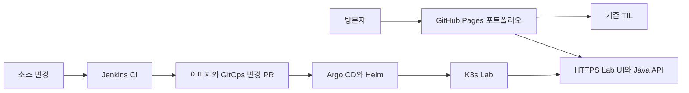

# DevDooly Platform Lab

Java 서비스의 개발부터 데이터 처리, 배포, 운영까지 직접 구현하고 결과를 공개하는 개인 플랫폼 프로젝트입니다. 합성 제조 데이터를 사용해 실무에서 다뤄 온 기술을 재현하고, 포트폴리오와 기존 [TIL](https://devdooly.github.io/TIL/)에서 설계와 검증 근거를 연결합니다.

**현재 상태: 계획과 로컬 Git 저장소 준비 완료. 애플리케이션과 서버 환경은 구현 전입니다.**

## 먼저 읽을 문서

| 문서 | 내용 |
| --- | --- |
| [시작 안내](docs/START_HERE.md) | 다음 작업의 순서와 구현 착수 조건 |
| [전체 구축 계획](docs/PROJECT_PLAN.md) | 기술 선택, 구조, 공개 범위, 자원 예산 |
| [진행 목록](docs/ROADMAP.md) | 단계별 작업과 완료 조건 |
| [첫 기술 결정](docs/adr/0001-platform-scope.md) | 정한 것과 아직 결정하지 않은 것 |
| [호스트 점검](docs/runbooks/host-inventory.md) | 기존 Ubuntu 환경을 확인하는 절차 |
| [검증 기록](docs/evidence/README.md) | 구현 결과를 남길 양식 |

## 만들려는 서비스

첫 버전은 Spring Boot API와 MariaDB로 작은 합성 데이터 작업의 결과를 조회합니다. Astro·React 화면에서 처리 결과, 소스 버전, 빌드와 배포 상태를 확인하도록 확장합니다.

공개 포트폴리오는 GitHub Pages에 두고, 실행형 Lab은 Ubuntu 미니 PC의 K3s에서 운영할 계획입니다. Jenkins는 CI를, Argo CD는 Helm 기반 GitOps 배포를 맡습니다. 공개 홈에는 검토한 실행 기록을 함께 게시해 Lab에 연결할 수 없는 때도 프로젝트를 읽을 수 있게 합니다.



Kafka·S3 호환 저장소는 4단계, Iceberg·Spark·Trino는 6단계에서 추가합니다. 새로 학습하는 제품과 이미 보유한 실무 경험은 포트폴리오에 구분해 표시합니다.

## 저장소 범위

```text
apps/api/                 Spring Boot API 구현 시작점
apps/lab-web/             Astro·React Lab UI 구현 시작점
tests/scenarios/          합성 데이터와 기대 결과
benchmarks/               공개 예제의 비교 측정
infra/ansible/            환경 점검 이후 작성할 호스트 구성
docs/                     계획, 결정, 운영 절차, 검증 기록
```

위 디렉터리에는 역할 안내만 있습니다. 실행 코드, Jenkinsfile, Helm chart는 해당 단계에서 실제 검증과 함께 작성합니다. 현재 실행할 빌드·테스트·배포 명령은 없습니다.

GitOps 저장소는 2단계에서 `devdooly-platform-gitops`라는 이름으로 별도 생성할 예정입니다. 공개 포트폴리오의 저장소와 Pages 주소는 1단계에서 기존 GitHub 저장소를 확인한 뒤 확정합니다. 이 로컬 저장소에는 아직 원격 저장소를 연결하지 않았습니다.

## 작업 원칙

- 먼저 기존 서비스, 데이터, 자원 사용량을 확인하고 작은 기능 하나부터 검증합니다.
- 모든 공개 데이터는 개인이 만든 합성 데이터로 구성합니다.
- 구현 상태는 계획, 진행 중, 검증 완료로 표시하고 검증 기록을 연결합니다.
- 운영 도구는 인증된 관리 경로에서 사용하고 공개 화면에는 허용한 요약만 제공합니다.
- 개인 접속 주소와 점검 원본은 Git에서 제외되는 `.local/`에 보관합니다. 인증정보와 회사 자료는 저장소에 넣지 않습니다.

개발을 시작할 때는 [시작 안내](docs/START_HERE.md)의 환경 점검부터 진행합니다.
