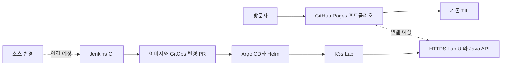

# DevDooly Platform Lab

Java 서비스 개발부터 데이터 처리, 배포와 운영까지 직접 구현하고 결과를 공개하는 개인 플랫폼 프로젝트입니다. 개인이 만든 합성 센서 데이터로 처리 규칙과 오류 대응을 재현하고, [TIL](https://devdooly.github.io/TIL/)에 설계와 검증 기록을 연결합니다.

[포트폴리오](https://devdooly.github.io/devdooly-platform-lab/) · [GitHub](https://github.com/DevDooly/devdooly-platform-lab) · [진행 목록](docs/ROADMAP.md)

## 현재 구현과 검증

| 영역 | 상태 | 근거 |
| --- | --- | --- |
| Spring Boot API | 합성 데이터 결과 조회, 입력 검증, DB 저장 구현 | [API 계약](docs/contracts/demo-api.md), [테스트 15개와 실제 HTTP 검증](docs/evidence/api-mvp/README.md) |
| Astro·React 화면 | 실시간 조회, 센서·실패 필터, 차트와 샘플 표시 구현 | [화면 검증](apps/lab-web/VALIDATION.md) |
| GitHub Pages | 최초 게시 성공, PC·모바일 조회 확인 | [공개 검증](docs/evidence/web-mvp/README.md), [게시 절차](docs/runbooks/pages.md), [게시 결정](docs/adr/0002-initial-public-portfolio.md) |
| MariaDB·컨테이너 | Compose와 digest 고정 이미지 구성, 설정 파싱 통과 | [통합 실행 안내](docs/runbooks/local-compose.md). 실제 컨테이너 실행 검증은 대기 |
| Jenkins·Argo CD·K3s | CI 정의·설치 설정과 앱 Helm chart 준비 | [Jenkins](docs/runbooks/jenkins-ci.md), [플랫폼 설치](docs/runbooks/platform-install.md), [앱 Helm](docs/runbooks/app-helm.md). 서버 설치·실행은 대기 |

개발 PC의 API 검증은 **H2 test/local-dev**로 수행했습니다. MariaDB와 미니 PC 배포 성공으로 해석하지 않습니다. 입력 12건의 기대 결과는 성공 7·실패 3·중복 2·대기 0입니다. 공개 사이트의 API가 연결되지 않으면 **합성 데이터 샘플**임을 표시하며, 실행 시각이나 배포 성공 이력을 만들어 넣지 않습니다.

## 로컬에서 실행하기

Java 21과 Node 24.19.0을 사용합니다. API와 화면은 별도 터미널에서 실행합니다.

```sh
cd apps/api
./mvnw -B -ntp verify
./mvnw spring-boot:run -Dspring-boot.run.profiles=local-dev
```

Windows에서는 `mvnw.cmd`를 사용합니다. 별도 터미널에서:

```sh
cd apps/lab-web
npm ci
npm run dev
```

화면은 `http://127.0.0.1:4321/`이며 `/api`를 로컬 API에 연결합니다. 전체 DB 구성을 확인하려면 [MariaDB·Compose 실행 안내](docs/runbooks/local-compose.md)를 따릅니다.

## 구축 순서

현재 미니 PC는 SSH 지문 확인과 공개키 등록을 기다리고 있습니다. 읽기 전용 환경 점검으로 기존 서비스·데이터·백업을 확인한 뒤 K3s를 설치하고 Jenkins CI와 Argo CD 배포를 연결합니다. 자세한 조건은 [시작 안내](docs/START_HERE.md)와 [전체 계획](docs/PROJECT_PLAN.md)에 있습니다.



Kafka·S3는 4단계, Iceberg·Spark·Trino는 6단계에 추가합니다. 실제 경력과 개인 구현·학습 중인 기술은 화면에서 구분합니다. GitOps 저장소는 별도 단계에서 구성합니다.

## 저장소 구성

```text
apps/api/                 Spring Boot, JPA·Flyway, 처리·HTTP 테스트
apps/lab-web/             Astro·React 포트폴리오와 Lab 조회 화면
tests/scenarios/          합성 데이터의 독립 기대 결과
infra/containers/         API·화면 이미지와 Nginx 설정
infra/charts/             API·화면·MariaDB 앱 Helm chart
infra/jenkins/            Kubernetes CI agent 정의
infra/platform/           K3s·Jenkins·Argo CD 설치 설정
infra/scripts/            읽기 전용 호스트 점검과 로컬 환경 준비
docs/                     계획, ADR, API 계약, 운영·검증 기록
benchmarks/               후속 단계의 공개 예제 비교 측정
```

회사 코드·데이터·실제 수율 알고리즘은 사용하지 않습니다. 실제 접속 주소와 점검 원본·인증정보는 Git에서 제외되는 `.local/`에 보관합니다. 관리자 도구는 인증된 관리 경로에 두고, 공개 화면에는 허용한 요약만 제공합니다.
