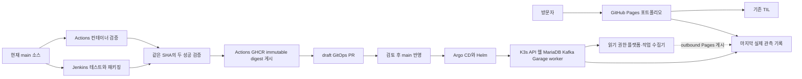

# DevDooly Platform Lab

Java 서비스 개발부터 데이터 처리, 배포와 운영까지 직접 구현하고 결과를 공개하는 개인 플랫폼 프로젝트입니다. 직접 만든 합성 센서 데이터로 처리 규칙과 오류 대응을 재현하고, [TIL](https://devdooly.github.io/TIL/)에 설계와 문제 해결 기록을 연결합니다.

[포트폴리오](https://devdooly.github.io/devdooly-platform-lab/) · [GitHub](https://github.com/DevDooly/devdooly-platform-lab) · [시작 안내](docs/START_HERE.md) · [진행 목록](docs/ROADMAP.md) · [다음 개발 계획](docs/NEXT_STEPS.md)

## 현재 구현과 검증

| 영역 | 확인한 결과 | 근거 |
| --- | --- | --- |
| Java 21·Spring Boot | JPA·Flyway, 작업/outbox·export·readiness, Linux API 180개 + 독립 예제 20개 | [API 계약](docs/contracts/demo-api.md), [실제 배포](docs/evidence/runtime-deployment/README.md) |
| Astro·React | 결과·실패 필터·차트, 웹 테스트 48개, 작업/export·readiness 기록과 AI 예제·데이터 흐름 준비 화면 | [기존 화면 검증](apps/lab-web/VALIDATION.md), [새 화면의 검증 범위](docs/evidence/iceberg-jdbc/README.md) |
| GitHub Actions·GHCR | Linux 컨테이너 통합 검증 후 immutable digest 이미지 게시 | [컨테이너 근거](docs/evidence/compose-ci/README.md), [이미지 게시](docs/runbooks/image-publication.md) |
| K3s·Helm·Argo CD | 미니 PC에서 앱 자동 동기화, Synced·Healthy, MariaDB PVC | [실제 서버 근거](docs/evidence/mini-pc/README.md), [GitOps 선언](gitops/README.md) |
| Jenkins·Actions 게시 gate | 같은 source SHA의 두 CI 성공 후 이미지·draft GitOps PR, 실제 테스트 실패 차단 | [연결 검증](docs/evidence/cicd-gate/README.md), [CI 절차](docs/runbooks/cicd-publication.md) |
| 플랫폼 관측 수집 | 최소 읽기 수집·실패 보존·게시 순서 교정과 timer 자동 게시 11회 성공 | [수집 검증과 남은 범위](docs/evidence/platform-observation/README.md), [공개 필드 계약](apps/lab-web/PLATFORM_OBSERVATION.md) |
| Kafka·Garage·상시 worker | 마지막 검증의 8개 EXPORTED 작업·파일 정보 16개·객체 24개·lag 0, readiness·idle 교체·같은 ID 재시도 | [최신 readiness 검증](docs/evidence/worker-readiness/CORRECTED_IMAGE.md), [이전 재시작](docs/evidence/runtime-recovery/README.md) |
| 관리자 접속 | ClusterIP 관리 화면과 SSH 접속 도우미 | [접속 방법](docs/runbooks/admin-access.md) |
| 백업과 복구 | 외부 암호화 사본의 Kafka/Garage PVC 격리 복원·별도 물리 블록 복원, 이전 DB/재부팅 검증 | [PVC 복원](docs/evidence/runtime-pvc-restore/README.md), [기존 복구 검증](docs/evidence/recovery/README.md) |
| 보존·자원 예산 | 삭제 없는 보존 계획기·별도 합성 PVC 정리, 실제 cgroup 설정과 작은 작업 3회 관측 | [운영 기준](docs/runbooks/retention-resource-budget.md), [실제 근거](docs/evidence/retention-resource-budget/README.md) |
| AI를 활용한 Java 개선 | UTC 오류 회귀·동일 결과 알고리즘·독립 Windows JMH와 정적 기록 UI | [예제](examples/java-window-analysis/README.md), [측정 조건·한계](docs/evidence/ai-window-analysis/README.md) |
| 입력·동시 접수 | 격리 최대 1,000개·동시 2/8개 접수 검증, 실제 K3s의 1,000건 처리·파일 보존 | [격리 조건](docs/evidence/input-concurrency-load/README.md), [실제 배포·게시](docs/evidence/input-v2-deployment/README.md) |

개인 합성 [Java 시간창 예제](examples/java-window-analysis/README.md)에서 UTC offset 오류를 재현·수정하고, 같은 답을 내는 O(n²) 기준 구현과 O(n log n) sweep을 비교했습니다. Java 테스트 20개·runner 검사 3개와 Windows Java 21의 JMH 16조합·48 fork·240 interval 측정을 완료했습니다. [실제 근거](docs/evidence/ai-window-analysis/README.md)와 [포트폴리오의 코드·기록 선택 화면](https://devdooly.github.io/devdooly-platform-lab/#ai-window)을 연결합니다. 일부 sparse 측정의 오차가 크며 회사 코드·수율 공식·운영 ETL 성능을 뜻하지 않습니다. 측정 당시 미커밋 소스 해시와 사람 검토 대기 상태를 유지합니다. [CI 연결의 검증 범위](docs/evidence/ai-window-analysis/ci-validation.md)는 성능 측정과 구분합니다.

마지막 운영 검증(2026-10-15 14:54 UTC)의 애플리케이션 소스는 `3e0d85be2f529026cb44812602e31c0e18797b45`, GitOps revision은 `75eb569b016c38c9cc1b1f5819a611b830f2b83d`입니다. Linux API 180개와 독립 Java 예제 20개 검증에서 실패·오류·skip은 0개였습니다. 실제 8개 EXPORTED 작업·export 정보 16개·원본 포함 객체 24개, Kafka offset/end 8·lag 0과 빈 실행 슬롯을 확인했습니다. 30초 승인 간격이 기록된 상태의 idle worker 교체와 읽기 전용 저장소 권한의 같은 작업 ID 재시도를 검증했습니다. 이전 worker 종료 코드는 UNOBSERVED이며, HTTP PUT 시도 횟수·서로 다른 ID의 실제 cooldown 거부·처리 중 호스트 장애는 이 검증에 포함하지 않습니다. [readiness 배포·후속 검증](docs/evidence/worker-readiness/CORRECTED_IMAGE.md)을 확인합니다. 이 시각의 검증 기록은 현재 서버의 실시간 가용성을 뜻하지 않습니다.

이전 V4 전환 당시 API·worker는 소스 `202ab6806130cfb37e8829ce7d52c89990d8a54a`·schema V4를 실행합니다. [실제 V4 전환](docs/evidence/admission-v4-deployment/README.md)은 API·웹 32/32, worker 35/35를 통과했고 기존 7개 작업·파일 정보 14개를 보존했습니다. 당시 신규 fixture 검증 전 상태이며, 후속 접수·교체·재시도 결과는 위 최신 근거로 구분합니다. 앞선 V2 배포에서는 소스 `6c5aff948770982dd44c8d44547131b3ccf6ddd9`로 고정 1,000건 입력을 처리했습니다. 실제 1,000건 작업이 성공 500·실패 300·중복 200·대기 0으로 끝났고, 신규 파일 3개와 기존 파일 18개를 전체 GET으로 검증했습니다. 전체 7개 작업·export 정보 14개와 Kafka offset 7/lag 0을 확인했으며, [공개 화면](https://devdooly.github.io/devdooly-platform-lab/#job-observation)의 전체 관측 JSON도 실제 수집 응답과 일치했습니다. [배포·보존·게시 근거](docs/evidence/input-v2-deployment/README.md)를 따릅니다.

앞선 [격리 입력·동시성 시험](docs/evidence/input-concurrency-load/README.md)에서는 정확한 1MiB 경계·동시 2/8개 접수의 단일 슬롯과 별도 Linux 1 CPU·768MiB worker의 1,000건 작업 3회를 검증했습니다. 당시 약 74.39초의 자원·지연 관측은 별도 시험 조건이며 운영 처리 용량이나 SLA로 표시하지 않습니다.

미니 PC의 웹을 통해 API·MariaDB를 조회하고 합성 입력 12건의 결과를 확인했습니다. 기대 결과는 성공 7·실패 3·중복 2·대기 0입니다. 공개 Pages는 **미니 PC에서 확인한 마지막 기록**과 수집 시각·source commit을 표시합니다. 현재 공개 홈에 미니 PC 실시간 API는 연결하지 않았습니다.

API의 Jenkins·Argo CD·Kubernetes `NOT_CONFIGURED`는 **조회 API 내부의 상태 수집 연결 전**을 뜻합니다. 별도의 정적 플랫폼 collector는 실제 서버 수집과 인증 실패 후 이전 성공 기록·수집 시각 보존 및 회복을 확인했습니다. 이 결과로 API 값을 정상으로 바꾸지 않으며, releases는 현재 JVM 정보입니다.

기존 플랫폼 관측의 2026-10-12 검증에서는 Jenkins 대상 SHA·Argo GitOps revision·API 배포 선언 소스와 image digest를 구분했습니다. 읽기 권한의 허용·거부와 출력 `0600`, 인증 실패 후 이전 성공 보존을 확인했습니다. 공개 화면은 1280px·390px에서 가로 넘침 없이 확인했습니다. 실제 게시 순서 역전에서 발견한 seed 회귀도 교정 후 재검증했습니다. **API·웹을 0개로 내린 동안에도 공개 홈·마지막 기록이 유지됐고 같은 정상 B로 복원했습니다. 전용 Pages 자격증명으로 수동 호스트 수집·실제 systemd service·timer 자동 실행과 Pages 게시를 확인했습니다. 최초 자동 실행을 포함한 11회의 Pages build·deploy가 모두 성공했고, 실제 서비스 완료 간격은 약 30분 26초~31분 15초였습니다.** timer는 enabled·active이며 자격증명 만료·회전과 장기간 운영은 아직 검증하지 않았습니다. [초기 공개 화면과 반복 실행의 근거](docs/evidence/platform-observation/README.md)를 구분해 기록합니다.

4단계의 Kafka·Garage·상시 worker를 미니 PC K3s에 GitOps로 배포했습니다. 최초 배포 검증에서 내부 `--lab-runtime=stage` 명령으로 고정 합성 입력 12개를 두 번 접수했고, 각 작업이 성공 7·실패 3·업무상 중복 2·대기 0으로 완료됐습니다. 결과·실패 파일 총 4개의 전체 Get·크기·SHA-256을 확인한 뒤 실행 슬롯이 비었으며 Kafka offset 2·log end 2·lag 0을 확인했습니다. 기존 seed·V1 행과 처리 시각, 기존 PVC와 Docker 전체 38개·실행 중 26개의 상태를 보존했습니다. [실제 배포·게시 근거](docs/evidence/runtime-deployment/README.md), [실행 절차](docs/runbooks/continuous-runtime.md), [관측 계약](docs/contracts/job-observation.md)을 연결합니다.

실제 미니 PC의 작업 관측과 플랫폼 관측을 Pages에 게시하고 공개 JSON 전체가 수집 원본과 일치함을 확인했습니다. 공개 화면은 실시간 API 대신 마지막 수집 기록을 읽으며, 약 30분 수집 주기·수집 시각과 5분 heartbeat 경고를 구분합니다. 새 job의 원래 timer 자동 수집·Pages 게시 2회와 공개 JSON 전체의 원본 일치를 확인했으며, 관측한 완료 간격은 1개·1809.371239초(30분 9.371초)입니다. [정기 실행 근거](docs/evidence/runtime-recovery/README.md)는 과거 플랫폼 collector 11회와 구분합니다. 공개 POST는 제공하지 않고 고정 fixture 접수는 내부 명령으로만 수행합니다. 단일 노드·partition 1/RF1의 Lab이며 고가용성·장기간 운영은 검증하지 않았습니다.

작업이 없는 실제 worker Pod 하나를 UID 조건·300초 종료 유예로 교체했습니다. 종료 로그와 STOPPED → 새 RUNNING, 정상 TERM exit 143, 교체 Pod의 restartCount 0·heartbeat 전진을 확인했습니다. 관측 절차는 17.808초였으며 같은 image/source를 사용했습니다. 기존 두 작업의 전체 SQL·처리 시각, 파일 4개의 실제 Get 결과와 Kafka offset 2·lag 0이 유지됐고 다른 Pod·Docker·PVC·호스트도 보존됐습니다. [실제 worker 재시작·원래 주기 게시 근거](docs/evidence/runtime-recovery/README.md)를 연결합니다. 진행 중 작업의 crash나 PVC 복원 시험과 구분합니다.

교체된 worker에 별도 고정 fixture `lab-fixture-20261015-recovery`를 접수해 입력 12 = 성공 7 + 실패 3 + 업무상 중복 2 + 대기 0, EXPORTED와 슬롯 해제를 확인했습니다. 새 결과·실패 파일 2개도 실제 Get의 전체 내용·크기·SHA-256을 대조했습니다. 전체 작업은 3개·확인 파일 6개가 됐고 Kafka offset 3·log end 3·lag 0입니다. 원래 두 작업의 전체 SQL·시각·HTTP 요약과 파일 4개는 그대로 보존했습니다.

Kafka·Garage 전용 PVC 3개를 정상 정지 구간에서 보관하고 AES-256-GCM 외부 사본의 인증·전체 해시를 확인한 뒤, 새 namespace·PVC에 복원했습니다. 전체 파일의 bytes·소유자·mode·나노초 mtime과 Kafka 3개 record의 key/value/시각·offset 3·lag 0, Garage의 원본 입력 3개·export 6개 GET을 대조했습니다. 원본 접근이 가능했던 probe가 격리 정책 적용 후 두 회차 모두 차단되고 DNS는 허용됨을 확인했습니다. [실제 PVC 복원 근거](docs/evidence/runtime-pvc-restore/README.md), [복원 절차](docs/runbooks/runtime-pvc-recovery.md)를 연결합니다.

기존 객체 9개는 모두 3,072 bytes 미만으로 metadata DB에 inline 저장돼 있었습니다. 별도 clone에만 128KiB canary를 한 번 PUT해 실제 data 블록 1개를 만든 뒤, 두 개의 추가 PVC로 cold 복원하고 Pod 교체 전후 각 10개 객체를 GET했습니다. 복제 Kafka도 UID 조건의 정상 TERM 교체 후 같은 PVC에서 3개 record와 offset을 보존했습니다. 원본 객체에는 쓰지 않았고 실행 image/source도 바꾸지 않았습니다. 시험용 workload 3개를 정상 종료해 Pod 0개·Retain PVC 5개를 남겼습니다. 최종 보존 검사 28개에서 원본 SQL·작업/파일 정보·PVC 6개·Ready Pod 6개와 기존 Docker 38개/실행 26개의 상태를 확인했습니다.

백업은 복구 호환 단위별 최신 검증본과 일 7개 날짜·주 4개 구간, trial은 최소 7일을 보호하는 [dry-run 정책](infra/maintenance/README.md)을 추가했습니다. 새 실제 inventory의 dry-run은 백업·trial 삭제 후보가 각각 0개였고 기존 보관 자료는 지우지 않았습니다. 새 64Mi 요청 PVC의 16KiB 합성 파일로 UID 거부·Retain/Released·정확한 파일/디렉터리 정리 경계를 검증했습니다. 이어 고정 12개 입력 3회로 총 6개 EXPORTED 작업·파일 12개 전체 Get·Kafka offset 6/lag 0을 확인했습니다. 약 63초·64개 샘플에서 worker 작업 구간 평균 CPU는 0.04235 core, 약 1초 관측 최대는 0.66622 core, `memory.current` 최대는 253.215MiB였습니다. 기존 limit을 바꾸거나 최대 부하를 시험한 결과는 아니며 [수치의 범위와 운영 기준](docs/runbooks/retention-resource-budget.md)을 함께 제공합니다. 최종 25개 검사에서 기존 PVC/PV 11개·원본 Pod 6개·Docker 38개/실행 26개·기존 SQL/원본 객체와 timer 설정·주기 보존도 확인했습니다.

기반 검증은 [DB](docs/evidence/db-job-foundation/README.md), [원본 S3](docs/evidence/s3-source-storage/README.md), [실제 MariaDB/Garage 결합](docs/evidence/mariadb-s3/README.md), [Kafka 중단·재전달](docs/evidence/kafka-redelivery/README.md), [결과 export](docs/evidence/result-export/README.md)에 구분해 기록했습니다.

별도 Linux worker의 1,000건 작업은 결과 파일 저장·GET 후 실패 파일 PUT을 Garage에 전달하기 직전에 SIGKILL 1회로 중단했습니다. 동일 JAR의 새 worker가 재계산 없이 export를 완료했고 첫 결과 파일·기존 4개 작업/12개 객체를 보존했습니다. 격리 검사 12/12·후속 운영 보존 18/18을 통과했으며 [정확한 중단 경계·준비 실패·회복 근거](docs/evidence/maximum-export-crash/README.md)를 제공합니다. 운영 worker 강제 종료나 진행 중 호스트 재부팅 결과는 아닙니다.

새 작업 승인 간격을 DB에 보관하는 V4를 실제 API→worker 순서로 배포했습니다. 기본 API 157개·격리 MariaDB/Garage 19개·복원본 이전 binary 호환 8개는 [기존 조건](docs/evidence/admission-cooldown/README.md)에 보존하고, [실제 전환](docs/evidence/admission-v4-deployment/README.md)은 별도로 연결합니다. 첫 worker 관측은 Kubernetes Ready 직후 runtime 초기화 전이라 32/35였고, 후속 동일 JVM의 RUNNING·heartbeat와 전체 35/35를 확인했습니다. 이전 컨테이너 exit는 UNOBSERVED이며 TERM을 추정하지 않습니다. 이 V4 전환 당시에는 신규 stage 검증 전이었습니다. 후속 고정 fixture·idle 교체·읽기 전용 재시도는 [최신 근거](docs/evidence/worker-readiness/CORRECTED_IMAGE.md)에서 확인합니다. 기존 timer가 11:40:08.792Z에 수집한 V4 기록은 [Pages 실행](https://github.com/DevDooly/devdooly-platform-lab/actions/runs/38728965840) 성공 후 12:01:58 UTC에 job·platform JSON 전체의 서버 원본 일치를 확인했습니다. [정기 게시 후속 근거](docs/evidence/admission-v4-deployment/PUBLICATION.md)를 별도로 연결합니다.

## 로컬 실행

Java 21과 Node 24.19.0을 사용합니다. API와 화면을 별도 터미널에서 실행합니다.

```sh
cd apps/api
./mvnw -B -ntp verify
./mvnw spring-boot:run -Dspring-boot.run.profiles=local-dev
```

Windows에서는 `mvnw.cmd`를 사용합니다. 화면은 다음과 같습니다.

```sh
cd apps/lab-web
npm ci
npm run dev
```

화면은 `http://127.0.0.1:4321/`이며 `/api`를 로컬 API에 연결합니다. 전체 DB 구성은 [MariaDB·Compose 안내](docs/runbooks/local-compose.md)를 따릅니다. H2 로컬 검증, Linux MariaDB 통합 검증과 미니 PC K3s 검증은 각각 기록합니다.

## 배포 구조



GitHub Actions가 유일한 이미지 게시자입니다. 현재 main의 같은 source SHA에서 Jenkins 테스트·필수 산출물과 Actions 통합 검증이 모두 성공해야 게시합니다. Jenkins는 전용 credential로 commit status만 전달합니다. Actions의 draft GitOps PR 자동 제안을 활성화했으며, 검토 후 main에 반영하면 Argo CD가 배포합니다. 자동 승인·자동 병합과 Jenkins의 `helm upgrade`는 사용하지 않습니다.

정상 B 배포에서 source SHA·image digest·GitOps commit·실행 이미지를 연결했습니다. 실제 JUnit 실패에서는 새 이미지·게시 artifact·GitOps PR이 생기지 않았고, 기존 B의 Deployment·Pod·전체 SQL·저장 시각·PVC와 기존 Docker 상태가 유지됐습니다. 이후 GitOps의 API/Web digest와 sourceCommit을 정상 A로 되돌려 Argo Synced·Healthy, 3개 Pod Ready와 기존 데이터·서비스 보존까지 검증했습니다. [정상·실패·복구 근거](docs/evidence/cicd-gate/README.md)를 함께 확인합니다.

기존 Docker 서비스·프록시·방화벽은 보존했습니다. K3s 기본 Traefik·ServiceLB는 사용하지 않습니다. 외부 암호화 백업, 격리 DB 복원, 호스트 재부팅과 GitOps의 이전 image digest 복구를 검증했습니다. K3s·Jenkins archive 전체 복원은 아직 별도 작업입니다. 3단계의 수집·공개 게시·순서 보존·API 웹 중단 후 복구와 자동 운영 기본 경로·반복 게시 11회를 검증했습니다. 자격증명 만료·회전과 장기간 운영은 후속이며 선택적인 실시간 API·inbound 연결은 별도 미구현 범위입니다. 새 inbound 경로는 열지 않았습니다. Kafka·S3는 4단계, AI 개선 재현은 5단계, Iceberg·Spark·Trino는 6단계입니다.

## 저장소 구성

```text
apps/api/                 Spring Boot, JPA·Flyway, 데이터·HTTP 테스트
apps/lab-web/             Astro·React 포트폴리오와 Lab 조회 화면
tests/scenarios/          합성 데이터의 독립 기대 결과
infra/containers/         API·웹 이미지와 Nginx 설정
infra/charts/             API·웹·MariaDB·Kafka·Garage·worker Helm chart
infra/jenkins/            Kubernetes CI agent 정의
infra/platform/           기반 도구의 버전과 설치 값
infra/scripts/            점검·bootstrap·관리 접속 도우미
gitops/                   Argo CD Application과 환경별 image digest
docs/                     계획, ADR, 계약, 운영·검증 근거
benchmarks/               후속 공개 예제의 전후 측정
```

회사 코드·데이터·실제 수율 알고리즘을 사용하지 않습니다. 실제 접속 주소·진단 원본·비밀값은 Git에서 제외한 `.local/`에 보관합니다. 공개 화면에는 허용한 요약만 제공합니다.

## 객체 참조 보호와 격리 GC

운영 DB의 전체 7작업·14 outbox와 S3 LIST 21객체를 읽어 전부 보호 대상으로 확인했습니다(19/19, 삭제 후보 0). 별도 새 Garage의 합성 객체 두 개만 삭제한 자연 GC 검증은 11/11을 통과했고, 고유 블록 2개의 allocated 2,105,344B 회수와 공유·보호 객체 보존을 확인했습니다. [실제 근거](docs/evidence/object-reference-gc/README.md), [순수 계획기](infra/maintenance/OBJECT_REFERENCE_PLAN.md)를 연결합니다. 운영 삭제 실행기·metadata DB 축소를 구현한 결과는 아닙니다.
