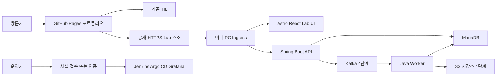
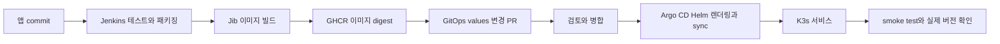

# 미니 PC 기반 개발 플랫폼과 포트폴리오 구축 계획

2026년 10월 11일 · 김선홍 DevDooly

진행 현황: GitHub 저장소를 연결하고 Java API·Astro/React 화면 MVP와 배포 설정을 구현했다. 로컬 API 검증은 H2이며 테스트 15개, 화면 테스트 4개와 실제 API HTTP smoke를 통과했다. MariaDB 컨테이너·Nginx DNS 갱신·처리 결과 보존은 임시 Linux runner에서 검증했고, 미니 PC 운영 검증은 대기 중이다. 서버 SSH 지문 확인·공개키 등록 후 읽기 전용 점검부터 진행한다. 공개 홈은 프로젝트 Pages `https://devdooly.github.io/devdooly-platform-lab/`로 정했다. 실제 호스트 주소는 Git에서 제외되는 `.local/host.md`에서 관리한다. 현재 완료 항목과 검증 한계는 [진행 목록](ROADMAP.md)에 기록한다.

Astro와 React로 별도 포트폴리오를 만들고, 소개 페이지는 GitHub Pages에 배포한다. 미니 PC에서는 K3s 위에 Java 서비스와 Jenkins CI, Argo CD CD를 구성한다. 방문자는 합성 데이터 처리 결과와 실제 배포 이력을 확인하고, 상세한 기술 설명은 기존 TIL로 이어서 읽는다.

첫 공개 목표는 작은 서비스 하나가 개발, 테스트, 배포, 운영으로 이어지는 과정을 보여주는 것이다. Kafka와 객체 저장소를 다음 단계에 붙이고, Iceberg·Spark·Trino·Airflow는 필요한 시나리오부터 확장한다. 아래 항목은 구축 계획이며, 완료 조건을 충족한 기능부터 사이트에 구현 상태와 증거를 표시한다.

## 1 목표와 현재 환경

| 항목 | 확인된 환경 |
| --- | --- |
| 운영체제 | Ubuntu, 세부 버전은 설치 전 확인 |
| CPU | AMD Ryzen 7 5700 |
| 메모리 | 32GiB, 실제 사용 가능한 메모리는 사전 점검 |
| 저장공간 | 전체 500GB 중 약 200GB 사용 가능 |
| 내부 주소 | `<mini-pc-lan-ip>`, 실제 값은 Git 제외 로컬 메모에 보관 |
| 기존 DDNS | `<lab-ddns-host>`, 실제 값은 Git 제외 로컬 메모에 보관 |
| 기존 문서 사이트 | https://devdooly.github.io/TIL/ |

기존 파일과 서비스를 유지한 상태에서 시작한다. Ubuntu 버전, 사용 중인 포트, 컨테이너·서비스, 디스크 구성, 현재 백업을 읽기 전용으로 조사한 뒤 설치 위치를 정한다. 남은 200GB를 새 프로젝트에 모두 배정하지 않는다.

사이트에서 확인할 핵심은 다음과 같다.

- Java·Spring Boot 서비스가 실제로 동작하고, 처리 결과를 API와 화면으로 확인할 수 있다.
- 소스 commit이 Jenkins 테스트와 이미지 빌드를 거쳐 Argo CD 배포 버전까지 연결된다.
- Kafka 처리 지연, 중복 이벤트, 실패·재처리 과정이 보인다.
- 코드 개선의 전후 결과와 테스트·측정 근거를 열어볼 수 있다.
- 서비스 장애나 미니 PC 전원 중단 때도 경력, 설명, 이전 실행 기록은 읽을 수 있다.

## 2 사이트와 기술 선택

### 포트폴리오 프런트엔드

**Astro와 React islands를 첫 선택으로 사용한다.** 경력과 프로젝트 설명은 정적 페이지로 만들고, 차트와 실행 상태처럼 상호작용이 필요한 부분만 React로 구현한다. Astro는 컴포넌트별로 브라우저 JavaScript를 추가하는 islands 구성을 지원한다. [Astro islands](https://docs.astro.build/en/concepts/islands/)

| 선택 | 적합한 용도 | 이번 계획의 판단 |
| --- | --- | --- |
| Astro와 React | 경력, 사례, 문서 연결, 일부 대화형 화면 | 기본안 |
| Next.js | 로그인과 사용자별 동작이 많은 웹 서비스 | 데모가 별도 제품으로 커질 때 재검토 |
| 기존 MkDocs | 설치 문서, ADR, 트러블슈팅, 학습 기록 | TIL에 계속 사용 |
| Backstage | 여러 팀과 서비스의 개발자 포털 | 개인 사이트 초기 범위에서는 보류 |

Next.js도 정적 export가 가능하다. 다만 이 프로젝트는 백엔드를 Java로 구성하므로 첫 버전에서 별도 서버 렌더링 계층을 추가할 필요가 크지 않다는 판단이다. [Next.js static exports](https://nextjs.org/docs/app/guides/static-exports)

### 주소와 역할

| 영역 | 배치 | 보여줄 내용 |
| --- | --- | --- |
| 공개 포트폴리오 | GitHub Pages | 소개, 경력, 대표 프로젝트, 설계, 영상, 측정 보고서 |
| 기술 위키 | 기존 /TIL/ | 상세 원인 분석과 재현 절차 |
| 공개 Lab | 미니 PC K3s | 데모 UI와 Spring Boot API, 공개용 실행·배포 현황 |
| 관리 도구 | 사설 접속 또는 별도 인증 | Jenkins, Argo CD, Grafana, DB·스토리지 관리 |

기존 사용자 사이트 저장소와 TIL은 유지하고, 우선 `DevDooly/devdooly-platform-lab`의 프로젝트 Pages `https://devdooly.github.io/devdooly-platform-lab/`에 공개 홈과 샘플 Lab을 게시한다. GitHub Pages를 Actions source로 설정했고 실제 게시 결과는 workflow에서 확인한다. 미니 PC 공개 API가 연결되기 전에는 합성 샘플과 미관측 상태를 명시한다. 선택 근거는 [ADR 0002](adr/0002-initial-public-portfolio.md)에 기록했다. [GitHub Pages 사이트 유형](https://docs.github.com/en/pages/getting-started-with-github-pages/what-is-github-pages)

공개 홈은 GitHub Actions로 정적 빌드·게시하고, 미니 PC Lab의 CI와 CD는 Jenkins와 Argo CD로 보여준다. 공개 홈의 가용성과 개인 서버 운영 실험을 분리하는 선택이다. [Astro GitHub Pages 배포](https://docs.astro.build/en/guides/deploy/github/)

## 3 방문자가 확인할 화면과 시나리오

### 대표 프로젝트

**합성 제조 데이터 처리 플랫폼**을 만든다. 회사 코드·데이터·실제 수율 알고리즘을 사용하지 않고, 공개용 센서 이벤트와 가상의 업무 규칙을 직접 정의한다.

첫 MVP는 Spring Boot API와 MariaDB로 처리 작업과 결과를 보여준다. 이후 Kafka로 비동기 처리 경로를 확장하고, 객체 저장소에 결과 파일을 보관한다. Kafka 도입 전후의 코드와 ADR을 남겨 구조를 바꾼 이유도 확인할 수 있게 한다.

1. 방문자가 미리 준비된 합성 데이터의 마지막 실행 결과를 조회한다.
2. 실행 기능을 공개한 뒤에는 작은 고정 샘플을 선택해 작업을 요청한다.
3. 화면에 접수, 대기, 처리, 완료 상태와 입력·성공·실패·중복 건수를 표시한다.
4. 처리 결과 그래프와 공개 가능한 결과 파일을 확인한다.
5. 같은 화면에서 현재 서비스 commit, 빌드 결과, 배포 시각, 지표의 관측 시각을 연다.

첫 버전은 조회 화면부터 공개한다. 실행 버튼은 서버의 작업량 제한과 실패 처리가 검증된 뒤 추가한다. 초기 정책값은 1회 최대 1,000개 이벤트, 전체 동시 처리 작업 1개, 요청 빈도 제한으로 시작해 실측 후 조정한다. 임의 파일, SQL, 코드, 배포 명령을 입력받는 기능은 넣지 않는다.

### 경력과 연결할 증거

| 경력의 역량 | 개인 프로젝트에서 보여줄 것 | 증거 |
| --- | --- | --- |
| Java와 Spring Boot | 수집·조회 API, 데이터 검증, 예외 처리 | API 명세, 소스, 통합 테스트 |
| Kafka | 중복·지연·실패·재처리와 lag | 시나리오별 처리 결과와 지표 |
| Jenkins와 Argo CD | commit부터 실제 서비스 버전까지 | 빌드 단계, image digest, GitOps 변경 |
| Kubernetes와 Helm | 프로브, 자원 설정, 선언 배포 | chart, 운영 결과, 재부팅 복구 |
| MinIO와 데이터 저장 | S3 API 연동과 결과 파일 관리 | 업로드·조회·정리 검증 기록 |
| Iceberg와 배치 처리 | 테이블 적재, 조회, compaction | catalog 구성과 작업 전후 리포트 |
| Linux와 Ansible | 반복 가능한 환경 구성 | 역할 정의, 재실행 결과, 복구 기록 |
| LLM 활용 코드 개선 | 공개 예제의 오류 수정과 연산 개선 | AI 제안, 채택 이유, 테스트와 측정 |

Hadoop 업그레이드, Bigtop 빌드, Tez·Trino 전환 경험은 설계 사례와 개인 재현 리포트로 연결한다. 전체 Hadoop 클러스터를 상시 켜 두는 일은 초기 목표에 포함하지 않는다. 필요할 때 작은 재현 환경을 실행하고 환경과 결과를 기록한다.

### 화면 구성과 방문 동선

- 소개: 현재 전문 분야, 실제 경력, 대표 데모, 공개용 이력서.
- 프로젝트: 전체 구조, 데이터 처리 흐름, 직접 맡은 부분과 기술 선택 이유.
- Lab: 샘플 처리 결과, 현재 버전, 배포 이력, 제한된 운영 지표.
- 개선 사례: 시간 처리 오류 또는 알고리즘 개선의 전후 증거.
- 기술 기록: 관련 TIL과 GitHub, ADR, 테스트·측정 원본.

방문자는 처음 15초에 전문 분야를 파악하고, 다음 40초에 처리 과정을 본다. 이어서 배포 이력과 개선 사례를 확인한 뒤 GitHub·TIL로 이동할 수 있게 한다. 각 카드에는 실무 경험, 개인 구현, 학습 중인 기술을 구분해 표시한다.

## 4 시스템과 저장소 구성

### 서비스 연결



Ubuntu에 K3s 단일 노드를 구성한다. 기본 Ingress와 local-path PV를 활용하고, 플랫폼·애플리케이션·데이터·모니터링 영역을 namespace로 나눈다. namespace는 권한과 자원을 구분하는 수단이며 물리적인 장애 분리는 아니다.

K3s 공식 최소 자원은 클러스터 기반 요구량으로, Jenkins·Java·DB·Kafka 전체 요구량을 뜻하지 않는다. 실제 워크로드에 맞춰 별도의 자원 예산을 둔다. [K3s 요구사항](https://docs.k3s.io/installation/requirements)

Lab UI는 정적 Astro·React 빌드를 Nginx 컨테이너로 제공한다. 같은 Lab 호스트의 `/api`를 Spring Boot로 연결해 기본 데모의 교차 출처 처리를 줄인다. 공개 홈에서 상태 API를 직접 조회한다면 CORS 허용 출처를 실제 포트폴리오 origin으로 제한한다. GitHub Pages의 `/TIL/`이나 `/portfolio/`는 경로이며 origin 구분 기준이 아니다.

### 저장소 제안

첫 구현은 애플리케이션과 GitOps 저장소 두 개로 시작한다. 포트폴리오 사용자 사이트를 루트 주소에 둘 때는 Pages용 저장소를 별도로 사용한다. `devdooly-platform-lab` 로컬 Git 저장소는 초기화했으며 아직 구현 코드는 없다. GitOps와 Pages 저장소는 후속 단계에서 생성 여부와 주소를 확정한다. 아래 구조는 구현 단계의 목표다.

```text
devdooly-platform-lab/
  apps/api/                 Spring Boot API
  apps/worker/              Kafka 소비 처리
  apps/lab-web/             Astro React Lab UI
  tests/scenarios/          합성 데이터와 검증 시나리오
  benchmarks/               공개 예제와 측정 결과
  docs/adr/                 기술 결정
  docs/runbooks/            운영과 복구 절차
  infra/ansible/            호스트 구성
  Jenkinsfile              2단계에서 실제 파이프라인과 함께 추가

devdooly-platform-gitops/
  charts/platform-lab/      직접 작성하는 애플리케이션 chart
  environments/lab/         이미지 digest와 환경별 values
  platform/                 Argo CD Application과 기반 구성

devdooly.github.io/         선택하는 경우 공개 포트폴리오
TIL/                       기존 저장소와 주소 유지
```

서드파티 chart도 버전을 고정하고 선택 이유를 기록한다. Git에는 코드와 선언 설정을 넣고 토큰·인증서 개인키·DB 비밀번호는 넣지 않는다. 초기에는 제한된 Kubernetes Secret과 별도 백업으로 시작하고, 이후 SOPS 같은 암호화된 선언 관리 방식을 추가할 수 있다.

## 5 CI와 CD의 동작



Jenkins는 테스트, 이미지 생성, 레지스트리 전송, GitOps 변경 PR까지 맡는다. Argo CD는 Git에 선언한 Helm chart와 values로 Kubernetes 상태를 맞춘다. 같은 애플리케이션에 Jenkins의 `helm upgrade`와 Argo CD 관리를 동시에 적용하지 않는다. [Jenkins Pipeline](https://www.jenkins.io/doc/book/pipeline/), [Argo CD automated sync](https://argo-cd.readthedocs.io/en/stable/user-guide/auto_sync/)

Jenkins controller의 executor는 0으로 두고 빌드는 agent에서 실행한다. Java 이미지는 Docker daemon 없이 만들 수 있는 Jib를 우선 검토한다. Lab UI 이미지는 rootless BuildKit을 검증한 뒤 별도 빌더에서 생성한다. 호스트 Docker socket을 Jenkins controller에 연결하는 구성을 기본값으로 사용하지 않는다. [Jenkins controller 분리](https://www.jenkins.io/doc/book/security/controller-isolation/), [Jib](https://github.com/GoogleContainerTools/jib)

이미지는 commit SHA 태그와 digest를 기록한다. 공개 fork PR의 테스트에는 레지스트리·GitOps 쓰기 자격증명을 전달하지 않고, 본인이 승인한 브랜치의 릴리스 작업에만 사용한다. GitOps 변경 PR이 병합된 시점을 배포 시작으로 기록하고, 배포 성공 여부는 실제 서비스의 버전과 smoke test로 확인한다.

### 롤백과 첫 검증

롤백은 GitOps에서 이전 image digest로 되돌리는 commit을 만들고 Argo CD가 동기화하도록 한다. auto-sync 애플리케이션의 직접 rollback에는 제한이 있으므로 UI의 rollback 버튼을 표준 절차로 삼지 않는다. 이미지 되돌리기는 DB 스키마와 데이터 복원을 대신하지 않는다. 초기 스키마 변경은 이전 앱과 호환되는 방식으로 작성한다. [Argo CD auto-sync와 rollback](https://argo-cd.readthedocs.io/en/stable/user-guide/auto_sync/)

첫 배포 검증은 정상 commit 배포, 실패한 테스트의 이미지 게시 차단, 이전 digest로 복구의 세 시나리오로 구성한다. 각각 소스 commit, 테스트 결과, 이미지 digest, GitOps commit, 배포·검증 시각을 남긴다.

공개 홈은 이 중 공개 가능한 요약만 읽는다. collector가 최소 조회 권한으로 내부 결과를 수집해 허용 필드를 저장하고, 방문자 API는 그 데이터만 반환한다. 브라우저에 Jenkins·Argo CD 토큰을 넣거나 원본 빌드 로그 전체를 전달하지 않는다.

검토한 최근 실행·배포 snapshot과 영상은 GitHub Pages의 정적 자산에도 게시한다. 공개 홈의 실시간 요청이 실패하면 이 자료와 수집 시각을 보여주고, 현재 상태와 구분해 표시한다. Lab UI 자체는 미니 PC 중단 시 열리지 않으므로 대체 자료는 공개 홈에 둔다. 연결 실패 표시는 원인을 단정하지 않는 ‘실시간 Lab 연결 불가’로 한다.

## 6 외부 접속과 공개 범위

### 접속 방식 선택

| 방식 | 전제 | 적용 판단 |
| --- | --- | --- |
| 개인 도메인과 Cloudflare Tunnel | 관리 가능한 도메인과 Cloudflare DNS 설정 | 장기 공개 주소의 우선안 |
| 기존 ipTIME DDNS와 HTTPS 프록시 | 외부 도달 가능한 회선, 공유기 설정, TLS 인증서 검증 | 도메인 추가 없이 진행하는 대안 |
| Tailscale Funnel | 해당 기능의 계정·정책·제한 확인, ts.net 주소 | 짧은 공개 시연의 대안 |

Cloudflare Tunnel은 `cloudflared`의 outbound 연결로 내부 서비스를 연결할 수 있다. 고정 호스트명 구성에는 사용자가 관리할 수 있는 DNS 영역이 필요하다. 기존 ipTIME DDNS는 제공받은 호스트이므로 이를 소유 도메인처럼 Cloudflare DNS에 그대로 연결할 수 있다고 전제하지 않는다. [Cloudflare Tunnel](https://developers.cloudflare.com/tunnel/), [Tunnel 시작하기](https://developers.cloudflare.com/tunnel/get-started/)

기존 DDNS를 사용하면 먼저 공인 IP·CGNAT 여부, 공유기 외부 접속 가능성, 이미 사용 중인 80·443 포트, 해당 호스트명의 TLS 발급·갱신 가능성을 확인한다. 가능한 경우 필요한 HTTPS 서비스만 Ingress 또는 프록시로 전달한다. DDNS 등록만으로 서비스 공개와 HTTPS가 완료되는 것은 아니다.

Tailscale의 사설 접속은 본인의 관리 접근에 사용하고, Funnel은 인터넷 공개 기능으로 별도로 구분한다. Funnel의 `ts.net` 주소와 사용 제한은 적용 시점의 공식 문서로 확인한다. [Tailscale Funnel](https://tailscale.com/docs/features/tailscale-funnel)

### 공개할 정보

| 접근자 | 허용하는 화면과 기능 |
| --- | --- |
| 공개 방문자 | 소개, 경력, 합성 데이터 결과, 승인된 데모 실행, 배포·운영 요약 |
| 운영자 | SSH, Jenkins, Argo CD, Grafana, 백업·관리 작업 |
| 내부 서비스 | Kafka, DB, S3 관리 API, 메트릭 수집, Kubernetes API |

공개 포트폴리오를 위해 Jenkins나 Argo CD 관리자 UI를 익명 공개할 필요는 없다. 사이트에서는 빌드 단계별 상태, 실제 서비스 버전, 공개 가능한 실행 결과를 제공하고 상세 운영 화면은 본인이 인증한 상태에서 시연한다.

Grafana의 Viewer 또는 anonymous 권한만으로 특정 패널에 대한 제한된 공개를 보장할 수 없다. 공식 보안 문서에서 Viewer의 데이터 소스 쿼리 범위를 설명하므로, 공개 화면은 집계 API나 검토한 snapshot을 사용한다. [Grafana 보안 설정](https://grafana.com/docs/grafana/latest/setup-grafana/configure-security/)

초기 Jenkins 트리거는 수동 또는 Poll SCM으로 시작한다. GitHub webhook을 추가할 때는 인증된 관리자 UI와 별도의 수신 경로를 두고 서명·중복 delivery를 검증한다. GitHub의 자동 요청이 사람의 로그인 화면을 통과한다고 가정하지 않는다. [GitHub webhook 검증](https://docs.github.com/en/webhooks/using-webhooks/validating-webhook-deliveries)

## 7 자원과 데이터 관리

### 메모리 예산

아래는 32GiB 장비에서 시작할 계획상 예산이다. 제품별 최소 요구량이나 실측치가 아니며, 기존 서비스의 사용량을 확인한 뒤 request·limit과 동시 실행 정책으로 구체화한다.

| 영역 | 메모리 예산 | 실행 방식 |
| --- | --- | --- |
| OS와 K3s 기반 | 4GiB | 상시 여유 포함 |
| Jenkins controller | 1GiB | 상시, 빌드는 수행하지 않음 |
| Jenkins agent | 4GiB | 빌드 때만, 동시 1개 |
| Argo CD | 1GiB | 상시 |
| Lab UI와 Spring API | 2GiB | 상시 |
| MariaDB | 1.5GiB | 상시 |
| Prometheus와 Grafana | 2.5GiB | 짧은 보존 기간으로 시작 |
| Kafka | 2GiB | 4단계 이후 |
| Java worker | 1GiB | 4단계 이후 |
| S3 호환 저장소 | 2GiB | 4단계 이후, 선택 제품에 따라 조정 |
| 합계 | 21GiB | 빌드 중 예상 예산 포함 |

나머지 11GiB는 기존 서비스, page cache, JVM overhead와 순간 사용량을 고려해 남긴다. 이를 모두 추가 앱에 배정하지 않는다. Spark·Trino·Airflow 실습은 CI 빌드와 겹치지 않게 실행하고, 메모리와 I/O를 측정한 뒤 상시 범위를 늘린다.

남은 디스크 200GB의 시작 예산은 애플리케이션 데이터 60GB, 이미지·빌드 캐시 35GB, 로그·메트릭 10GB, 검증 자료·백업 임시 공간 15GB, 미할당 여유 80GB로 둔다. Kafka retention과 결과 파일 보존 기간, 빌드 캐시 정리 기준을 함께 설정한다. 원본 데이터는 작은 합성 샘플부터 시작한다.

### 데이터 스택 선택

Kafka는 개발·데모용 단일 broker/controller KRaft로 시작한다. 한 물리 서버 안에서 Pod를 늘리는 구성을 서버 장애에 견디는 HA라고 표시하지 않는다. [Kafka KRaft](https://kafka.apache.org/42/operations/kraft/)

MinIO 공식 Community 저장소는 2026년 4월 25일 archive되었고 유지보수 종료를 명시한다. 새 공개 서비스에 과거 Community 이미지를 기본값으로 고정하지 않는다. 기존 실무의 MinIO 경험은 경력에 그대로 표시하되 신규 실습 저장소와 구분한다. [MinIO 공식 저장소](https://github.com/minio/minio)

상시 저장소는 SeaweedFS를 S3 호환 후보로 검토한다. Spring SDK 업로드·다운로드·multipart·presigned URL과 필요한 삭제·버저닝 동작을 검증한 뒤 선정한다. S3 호환이라는 표현만으로 MinIO와 모든 기능이 같다고 간주하지 않는다. MinIO 제품 자체를 재현해야 하는 항목은 AIStor Free의 라이선스와 기능 범위를 확인해 별도 실습으로 구성한다. [SeaweedFS](https://github.com/seaweedfs/seaweedfs), [AIStor 라이선스와 제한](https://docs.min.io/aistor/operations/licenses/)

Iceberg 확장에는 객체 저장소 외에 영속 catalog를 포함한다. Spark와 Trino가 동일 catalog·warehouse를 참조하고, 재시작 후 테이블 메타데이터를 다시 조회하는 것까지 검증한다. catalog 구현과 backing DB는 이 단계의 ADR에서 결정한다. Iceberg 자체를 별도 실행 서버처럼 설명하지 않는다. [Trino Iceberg connector](https://trino.io/docs/current/connector/iceberg.html)

### 백업과 복구

GitOps 설정만으로 DB·파일·자격증명이 복원되지는 않는다. MariaDB dump, 객체 파일, Jenkins 설정과 credentials, K3s datastore와 server token 등 실제 복구에 필요한 항목을 별도로 보관한다. 외장 디스크나 다른 저장 위치에 암호화한 백업 한 벌을 둔다.

local-path PV는 노드에 저장되는 볼륨이며 분산 복제 저장소가 아니다. K3s datastore 백업도 애플리케이션 PV를 대신 백업하지 않는다. [K3s 저장소](https://docs.k3s.io/add-ons/storage), [K3s 백업과 복원](https://docs.k3s.io/datastore/backup-restore)

복구 검증은 테스트 namespace의 샘플 데이터를 별도 볼륨에 복원해 결과를 조회하는 방식으로 수행한다. 기존 서비스의 볼륨을 삭제하며 실험하지 않는다. 백업 파일 생성 시각, 복구한 데이터 범위, 소요시간과 검증 결과를 남긴다.

## 8 단계별 진행과 완료 조건

### 단계 0 기존 환경 확인

Ubuntu 지원 상태, 포트·서비스·컨테이너, 메모리·디스크, 네트워크·DDNS, 백업을 확인한다. SSD 여부와 현재 사용 중인 서비스도 이때 확인한다. 설치 디렉터리와 PV 경로를 정하고, 변경 전 상태와 복구 방법을 기록한다.

완료 조건: 기존 서비스 목록, 새 프로젝트 자원 예산, 사용할 주소·접속 방식이 정리되어 있고 원래 서비스에 영향을 주지 않는 설치 범위가 정해져 있다.

### 단계 1 공개 포트폴리오와 최소 Java 서비스

Astro 소개 페이지와 TIL 연결을 만들고, Spring Boot의 샘플 작업·결과 조회 API와 MariaDB를 구현한다. 먼저 로컬에서 동일 샘플을 반복 실행해 예상 결과를 검증한다. 공개용 이력서는 제출용 이력서와 별도로 준비한다.

완료 조건: 첫 화면에서 경력과 대표 프로젝트를 이해할 수 있고, API 명세·테스트·샘플 결과가 존재한다. 미구현 항목은 계획으로 표시한다.

### 단계 2 K3s와 Jenkins 및 Argo CD

K3s, Jenkins controller·agent, Argo CD, GHCR을 연결한다. 애플리케이션 Helm chart와 GitOps values를 작성하고 정상 배포·실패 차단·Git revert 복구를 검증한다. 초기에는 수동 또는 Poll SCM으로 트리거한다. 외부 공개 전에 기본 DB, Jenkins 설정·credentials와 필요한 클러스터 설정의 외부 백업을 확보한다.

완료 조건: 한 소스 commit과 실제 서비스 버전이 연결되며, 이전 digest로 돌아간 증거가 있다. 재부팅 뒤 필요한 서비스가 복구된다.

### 단계 3 외부 공개와 운영 요약

선택한 HTTPS 방식으로 Lab UI와 제한된 API를 공개한다. 관리자 도구는 사설 접속 또는 인증 뒤에 둔다. 휴대폰 외부망으로 접속·TLS·API 경로를 확인한다. 검토한 최근 실행·배포 snapshot과 영상, 수집 시각을 GitHub Pages 정적 자산에도 게시한다. 별도 도메인 구매나 공유기 설정 변경은 실제 적용 단계에서 진행한다.

완료 조건: 로그인 없는 방문자가 데모 결과와 배포 현황을 보고, 관리자 기능에는 접근하지 못한다. 실시간 요청 실패 시 공개 홈에서 ‘실시간 Lab 연결 불가’와 마지막 snapshot의 수집 시각을 표시한다.

### 단계 4 Kafka와 객체 저장소

Kafka producer·worker·멱등 키·재시도·실패 이벤트 보관을 구현한다. 검증을 통과한 S3 호환 저장소를 연결하고 결과 파일을 제공한다. Prometheus·Grafana로 지연과 사용량을 관측한다.

완료 조건: 중복·시간 역순·실패 데이터를 넣어도 조용히 유실되지 않으며, 각 입력 건수가 성공·실패·중복·대기 결과로 설명된다. 샘플 실행 한도와 보존 정책이 적용된다.

### 단계 5 LLM 개선 사례와 복구 기록

별도의 공개 예제에 연산 비효율과 시간 처리 오류를 의도적으로 만들고 개선한다. AI 제안, 채택·수정 이유, 테스트 결과, 측정 조건을 기록한다. 외부 백업으로 DB·파일 복구를 검증하고 운영 문서를 TIL로 연결한다.

완료 조건: 개선 전 실패·개선 후 성공한 테스트와 재현 가능한 측정 원본이 존재한다. 개인 예제의 수치를 실무 성과로 표시하지 않는다. 복구 결과와 소요시간을 다시 확인할 수 있다.

### 단계 6 데이터 플랫폼 확장

Iceberg와 영속 catalog를 추가하고 Spark Job으로 적재·compaction을 실행한다. Trino 조회를 연결하고, 반복 실행 관리가 필요한 경우 Airflow DAG를 추가한다. 초기에는 실습 시간에만 기동한다.

완료 조건: 동일 warehouse의 쓰기·조회·재시작·compaction 결과가 검증되어 있고, 실행 중 자원 측정과 종료·복구 절차가 있다.

단계 번호는 의존 순서이며 일정 약속이 아니다. 각 단계를 완료할 때 다음 단계의 자원과 필요성을 다시 판단한다. 첫 공개 범위는 단계 1부터 3까지로 잡는다.

## 9 API와 공개 증거의 규격

### 첫 API 계약

| 경로 제안 | 목적 | 공개 정책 |
| --- | --- | --- |
| GET /api/demo/runs | 공개 샘플 실행 목록 | 허용 필드만 반환 |
| GET /api/demo/runs/{id} | 단계·건수·결과와 관측 시각 | 임의 내부 작업 접근 차단 |
| POST /api/demo/runs | 고정 샘플 실행 요청 | 실행 제한 검증 후 공개 |
| GET /api/platform/releases | 빌드·배포와 실제 버전 | 원본 관리 API를 프록시하지 않음 |
| GET /api/platform/summary | 공개 지표와 관측 시각 | 미리 정한 지표만 조회 |

공개 실행 결과에는 입력·성공·실패·중복·대기 건수와 소요시간을 포함한다. 배포 기록에는 source commit, image digest, GitOps commit, deploy time, 실제 서비스의 버전 확인 결과를 연결한다. 실행 시각과 관측 시각을 구분하고, 과거 snapshot을 실시간 결과처럼 표시하지 않는다.

### 테스트와 측정

- API·데이터: 빈 입력, 중복 키, 잘못된 시간, 시간 역순, 실패 후 재처리.
- Kafka: consumer 중단·재시작, lag 증가·회복, 중복 이벤트의 최종 결과.
- CI/CD: 실패한 테스트의 게시 차단, 선언과 실제 버전 일치, Git revert 복구.
- 운영: 재부팅, 디스크·로그 보존량, 백업 복원, 외부망 접속.
- 코드 개선: 독립적인 기대값, 경계값, 개선 전후 결과 일치, 입력 크기별 비용.

측정 리포트에는 데이터 seed와 크기, CPU·메모리, JVM·라이브러리 버전, 코드 commit, warm-up, 반복 횟수, 측정 방식과 원본을 남긴다. 입력 조건을 고정한 비교 결과가 나오기 전에는 개선율을 작성하지 않는다.

작업별 결과는 `docs/evidence/<scenario>/`에 저장한다. 현재 `docs/evidence/README.md`에 기록 양식만 준비되어 있다. 설명, 실행 명령, 환경, 테스트 결과, 측정 원본, 공개 가능한 이미지·영상, 한계와 재현 절차를 함께 둔다. 실제 회사 사례, 개인 재현, 앞으로 할 계획을 구분한다.

## 10 다음 구현에서 시작할 작업

첫 작업은 원격 설치보다 환경 조사다. Ubuntu에서 현재 실행 중인 서비스와 기존 데이터 사용량을 확인하고 이 계획의 자원 예산을 조정한다. 이후 공개 포트폴리오 뼈대와 최소 Java 서비스를 개발한 뒤 CI/CD를 붙인다.

SSH 키는 문서 작성 단계에는 필요 없다. 실제 원격 작업을 시작할 때 전용 계정·접속 포트·기존 SSH 정책을 확인한다. 접속하는 클라이언트에서 전용 키를 만들고 공개키만 서버의 해당 사용자에 등록한다. 개인키는 클라이언트에 보관하고 채팅이나 Git에 넣지 않는다. 처음 접속할 때 서버 호스트 키 지문을 확인하고, 새 키 접속 검증 전에는 기존 접속 방식을 없애지 않는다.

다음 구현 요청은 이 저장소의 `AGENTS.md`와 `docs/START_HERE.md`를 읽는 것부터 시작한다. 요청 범위의 예시는 다음과 같다.

> Ubuntu 미니 PC의 기존 서비스를 보존하면서 환경을 읽기 전용으로 조사하고, devdooly-platform-lab의 Astro 포트폴리오와 Spring Boot 샘플 API를 만들어 주세요. 실제 사용량으로 자원 예산을 조정하고, GitHub Pages용 소개와 미니 PC용 Lab을 구분해 주세요. 먼저 로컬 샘플 처리와 결과 조회를 완성하고, 그 다음 Jenkins CI와 Argo CD·Helm GitOps 배포를 연결합니다.

첫 실제 구축 전에 남은 선택은 Ubuntu 버전과 기존 서비스 확인, 외부 접속 방식, 백업 저장 위치, GitHub Pages 루트 또는 프로젝트 주소다. S3와 catalog 제품은 해당 확장 단계에서 호환성 검증 후 결정한다.
