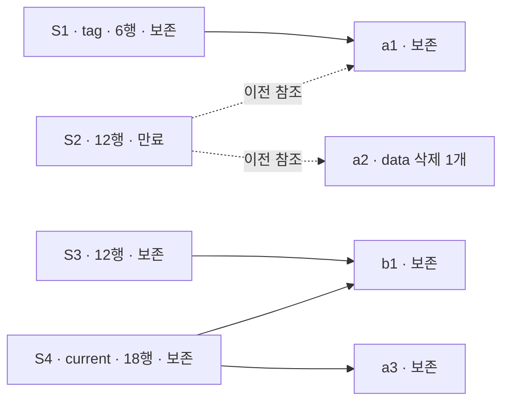

# 새 격리 warehouse의 Iceberg snapshot 만료

[Hosted 실행 39140688897](https://github.com/DevDooly/devdooly-platform-lab/actions/runs/39140688897)은 [고정 소스 482d3ca4](https://github.com/DevDooly/devdooly-platform-lab/tree/482d3ca4b564282feceb31f392c6a981302a7c2d/infra/cloud-lakehouse-expiration)에서 `COMPLETE / PASSED / VERIFIED`로 통과했습니다. [실제 유한 summary](summary.json)는 원 artifact의 1,908바이트를 그대로 보존합니다. 수집 시각은 2026-10-18 15:31:51.263387 UTC이며 한국 시각으로는 10월 19일입니다. 새 Cloud 합성 자원만 사용했고 미니 PC·운영 warehouse에는 접속하지 않았습니다.

## 네 snapshot과 공유 파일

다음 이름은 실제 key·UUID 대신 사용한 **합성 별칭**입니다. 그림은 만료 전 snapshot의 **live data 참조**와 만료 후 판정을 함께 표시합니다. S2를 만료해도 S1 tag가 참조하는 a1과 S3/S4가 공유하는 b1은 보존하며, 남은 snapshot이 참조하지 않는 a2 하나만 삭제합니다.

이 그림은 warehouse 전체 파일이나 물리 저장 블록의 관계를 뜻하지 않습니다. 과거 metadata JSON bytes를 보존했다는 사실도 data 파일이 삭제된 S2의 복원 가능성을 증명하지 않습니다.

## 실제 확인 결과

| 항목 | 확인한 값 |
| --- | --- |
| Snapshot | 1개 만료 · S1/S3/S4 3개 보존, tag·current 유지 |
| 삭제 | data 1개 · manifest 1개 · manifest list 1개 |
| 보호·사후 객체 | 보호 22개 · 기존 survivor 22개 · 신규 metadata 1개 · 사후 전체 23개 |
| Spark 행 대조 | tag 6행 · 보존한 이전 snapshot 12행 · current 18행 · Silver 12행 |
| Trino SELECT 4개 | version · current Bronze 18행 · DOUBLE schema · Silver 12행 |
| 보존 | JDBC pointer·사후 warehouse 전체 GET bytes, 생존 process identity·고정 source pin 일치 |
| 종료·정리 | Spark·Trino·Python reader 정상 종료, initializer·소유 bound 컨테이너 stop 확인 |

선택 data key의 삭제는 만료 전 GET와 만료 후 동일 key의 `NoSuchKey`/404 및 삭제 counter·사후 객체 대조를 통해 확인하는 고정 검사를 통과했습니다. 단순 LIST 부재·403·timeout을 삭제 성공으로 판단하지 않습니다. **Trino가 tag나 과거 snapshot을 조회했다는 근거는 아닙니다.** tag·과거 snapshot의 행 대조는 Spark에서 수행했습니다.

메모리·이미지·vendor·새 volume·내부망·단일 clock·만료와 보존 등 summary의 선택된 검사 13개가 모두 true였습니다. 성공 workload는 첫 PG/Garage 시작부터 소유 컨테이너 stop을 포함해 **93,699ms**였으며 600초 예산 안에 끝났습니다. 이미지 pull/build·고정 JAR 준비는 이 시간에서 제외됩니다. 이는 한 실행의 관측값이며 전체 준비 시간·반복 성능이나 SLA가 아닙니다.

## 적용 범위와 남은 한계

원 소스 16개, 기존 native 근거와 운영 보존 계획기의 KEEP·`applyEnabled:false`는 유지합니다. 실제 만료는 이 새 warehouse에서 한 번만 수행했고 자동 재호출은 하지 않았습니다. metadata commit과 객체 삭제의 원자성·운영 장애 복구를 증명하지 않습니다.

정리는 소유 bound 컨테이너의 stop 확인입니다. 볼륨 삭제·Garage 물리 블록 GC·실제 공간 회수·장기간 가용성·성능은 검증하지 않았습니다. `volumesDeleted`, `physicalStorageGcVerified`, `productionPlannerApplyEnabled`, `miniPcContacted`는 모두 false입니다. 원시 로그·자격증명은 공개 결과에 포함하지 않습니다.
