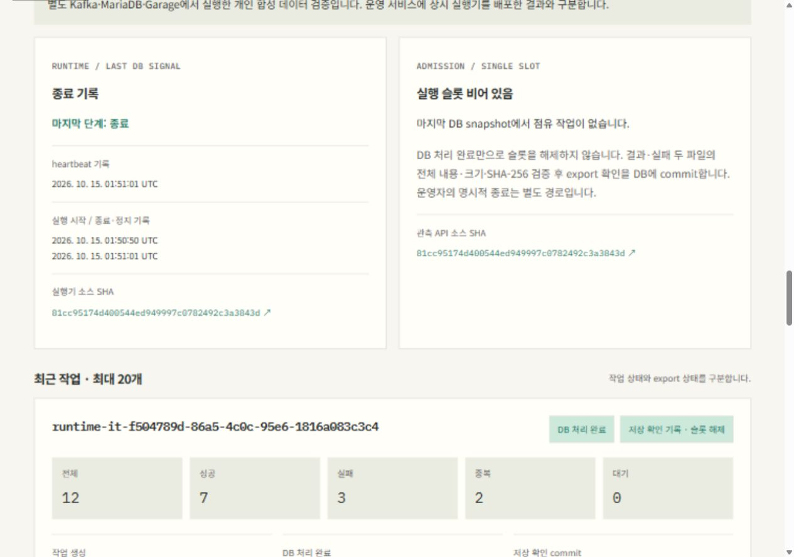

# 상시 worker/export 실행과 작업·파일 관측 검증

2026-10-15 KST에 실제 Kafka 4.3.1·MariaDB 11.8.9·Garage 2.4.1과 Windows Java 21·Asia/Seoul에서 격리 검증했다. 기본 verify **120개**, 별도 실제 IT **4개**, 웹 **34개**·타입 검사·Pages 경로 빌드가 모두 통과했다.

[실제 수치와 보존 결과](summary.json) · [최종 API 소스 지문](source-fingerprint.json) · [실행 절차](../../runbooks/continuous-runtime.md) · [ADR 0008](../../adr/0008-continuous-runtime-observation.md) · [관측 계약](../../contracts/job-observation.md)

## 실행과 회복

| 실제 시험 | 확인한 결과 | 최종 log end / offset / lag |
| --- | --- | --- |
| 같은 daemon의 두 작업 | 하나의 생산 runner/actions가 독립 접수 2개를 자동 발행·수신·export. 각 결과 12개·파일 2개 확인 뒤 슬롯 해제. HTTP NOT_STARTED→RUNNING 두 EXPORTED→STOPPED 관측 | 2 / 2 / 0 |
| 첫 export 파일 뒤 JVM 종료 | 실제 전체 Get·atomic checkpoint와 DB/offset을 대조한 뒤 Windows child JVM 1회 강제 종료. 새 실행기는 export부터 복구하고 기존 DB 결과·시각·offset 보존 | 1 / 1 / 0 |
| 영속 정지·명시적 재개 | 손상 raw로 PAUSED_OPERATOR와 슬롯·offset 보존. 실제 run CLI 재시작 거부를 고정 exception type으로 확인. 소유 fixture 복구와 실제 resume CLI 뒤 완료 | 1 / 1 / 0 |
| 경쟁 실행 거부 | 실제 run CLI가 MariaDB named lock을 얻지 못하고 활성 journal을 바꾸지 않음. 소유 runner는 처리를 계속 완료 | 1 / 1 / 0 |

총 4개 시나리오에서 서로 다른 완료 run 5개·검증 문서 10개를 확인했다. 정상 2-run 시험의 outcome은 24개, 나머지는 각각 12개다. 각 run의 판정은 12 = 성공 7 + 실패 3 + 업무상 중복 2 + 대기 0이며 최종 runtime STOPPED·빈 슬롯·lag 0이었다. 정지/경쟁 거부의 nonzero exit만으로 합격하지 않고 실제 고정 거부 exception type과 journal/offset 보존을 대조했다.

정상 daemon 시험 helper는 production `ContinuousJobRunner`·`JobRuntimeActions`·`RuntimeResources`를 직접 조립해 실제 연속 loop를 실행했다. 정상 종료는 helper의 소유 stop file이 production `requestStop`을 호출한 결과다. 실제 run CLI는 정지 재시작 거부와 경쟁 lock 거부를, resume CLI는 정지 해제를 검증했다. 정상 run CLI 전체 기동·OS signal·systemd·Linux Pod 상주를 검증한 결과로 확대하지 않는다. force kill은 단순 예외나 임의 sleep이 아니라 첫 객체 확인 checkpoint 뒤 실제 Windows JVM을 종료한 한 번이다.

## 실제 관측과 화면

[등록한 HTTP 기록](../../../apps/lab-web/public/observations/jobs.latest.json)은 실제 별도 조회 API의 응답과 전체 JSON이 같고 strict validator를 통과했다. 소스는 `81cc95174d400544ed949997c0782492c3a3843d`, capturedAt은 JSON의 실제 시각이다. 기능 코드를 먼저 커밋해 이 SHA로 실행했고 문서·기록 등록은 후속 커밋으로 분리했다. API/실행기 Java 소스 지문은 동일하다.

화면은 격리 Lab 기록·실시간 아님·STOPPED·빈 슬롯·두 EXPORTED 작업과 입력 회계식, 저장 확인 시각, 파일 예상 hash/크기를 표시했다. SHA/크기는 불변 DB 결과에서 재계산하며 관측 API의 현재 S3 재조회가 아니다. 1280×900·390×844에서 document 가로 넘침이 없었고 본문·주석은 17px이었다. 모바일 SHA 펼침도 확인했고 임시 viewport override를 복원했다.

[모바일 파일 SHA 펼침 화면](mobile.jpg)

## 정리와 기존 운영 보존

소유 UUID raw/export 객체·topic/group·DB 작업/outbox/run/outcome·trigger를 정리했다. V1/V2/V3 각각 성공 1회·빈 singleton slot을 확인했다. broker는 제거 전 restart 0·OOM false였고 전용 container 3개·DB/Kafka named volume 2개·internal network 1개를 제거했다. 비공개 Garage 진단 자료는 남겼다.

고정 전후 관측으로 기존 Docker 전체 38개 ID와 실행 중 26개의 start time/mount, 운영 Pod 3개·PVC 2개, 전체 SQL/Flyway·처리 시각·API 저장 필드·image pin/source·Argo revision·host boot·node·방화벽 보존을 확인했다. 이번 작업은 운영 배포/롤백이나 공개 Pages 게시를 수행하지 않았다. 로컬 미리보기만 열어 신규 관측 화면을 검증했다.

## 한계와 다음 단계

기본 API는 자동 worker/Kafka/S3 client를 만들지 않는다. 새 GET 계약과 정적 기록은 기존 두 관측 계약·collector 게시 자동화와 별개다. 오류는 영속 정지하며 명시적 resume이 필요하고, DB/lease 실패로 journal을 갱신하지 못하면 마지막 RUNNING이 남을 수 있다. named lock은 단계 소유 확인이며 외부 IO의 원자적인 fencing·HA가 아니다.

현재 숫자 loopback/SSH 시험 연결과 단일 partition/RF1·원본 12개 범위다. 다음은 운영용 접속·인증·worker/Kafka/Garage 배치와 자원/보존 조건을 확정하고 제한된 GitOps 배포를 검증하는 일이다. job 관측의 outbound 자동 수집·Pages 게시, OS 재시작 정책·자격증명 회전·최대 1,000개·다중 partition·공개 실행은 후속이다.
