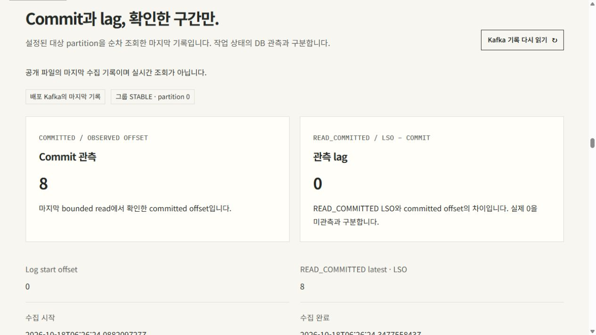
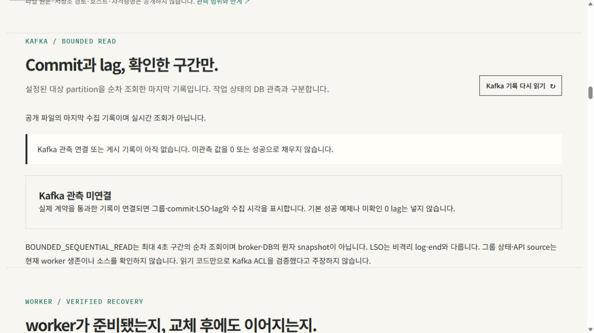
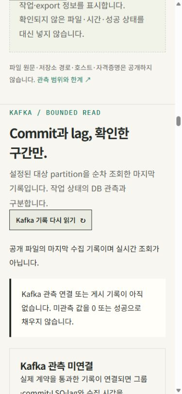

# Kafka 관측: 현재 전환 상태와 이전 로컬 검증

## main 반영·이미지 전환·활성화 검증

2026-10-18 소스 `245d61a5`의 [컨테이너 검증](https://github.com/DevDooly/devdooly-platform-lab/actions/runs/39101005714), 같은 SHA의 Jenkins 54, [Pages 배포](https://github.com/DevDooly/devdooly-platform-lab/actions/runs/39101005717), [이미지 게시](https://github.com/DevDooly/devdooly-platform-lab/actions/runs/39101367277)를 확인했다. [API·웹 이미지 #66](https://github.com/DevDooly/devdooly-platform-lab/pull/66)을 반영한 뒤 06:11 UTC의 새 읽기 점검에서 OCI index→amd64 manifest→config와 CRI·Pod imageID·소유 관계를 확인했다. 기본 비활성 GET은 고정 JSON의 503·NOT_CONFIGURED·no-store였다. worker의 기존 소스·이미지, 업무 DB·PVC/PV·Docker·timer는 보존됐다.

새 로컬 DB·K3s 백업과 순차 보존 점검을 통과했다. 앞선 Application 비교 실패는 유지한다. 별도 읽기에서 UID·이름·spec 전체가 같고 generation만 증가했으며, 설치된 CRD의 served version에는 status subresource가 없었다. 해당 계약을 다시 확인하는 경우에만 Application generation을 비교 복사본에서 정규화하고 나머지 전체 비교를 유지했다. 각 generation 증가를 일으킨 개별 상태 쓰기나 원래 실패 당시의 정확한 원인은 소급 확정하지 않는다.

이후 [활성화 설정 #67](https://github.com/DevDooly/devdooly-platform-lab/pull/67)이 06:15 UTC에 main `e94bc5b1`로 반영됐다. 06:20 UTC의 새 읽기 전용 점검에서 애플리케이션 소스 `245d61a5`를 유지한 API의 활성화 설정과 HTTP200·엄격한18필드 관측 계약을 확인했다. 활성화 플래그와 Kafka 환경 설정4개만 바뀌는 경계, API·웹 Pod 소유 관계와 OCI→CRI·imageID 연결, 기존 worker 소스·이미지와 업무 DB·PVC/PV·Docker·timer 보존을 통과했다. API Pod는 활성화 설정 적용을 위해 새로 생성됐으며 다른 업무 workload·Pod 보존과 구분한다.

위 활성화 점검은 순차 읽기이며 원자적 동시점 상태·서비스 전체 복원·offset 변경·실제 부하 시험을 수행하지 않았다. 이번 로컬 백업을 외부 사본·복원·Kafka/Garage 동시점 백업으로 확대하지 않는다. 접속 주소·자격증명과 비공개 백업·보존 identity는 공개 문서에 포함하지 않는다.

## collector 설치·수동 공개 게시 검증

첫 설치 실행은 전제조건 확인에 실패했다. 후속 읽기 전용 진단에서 기존 코드 6개가 root 소유·0600이고 후보는 0644를 기대했다는 차이를 확인했다. 기존 6개 파일의 이전 상태·새 2개 파일 부재와 timer enabled·active도 확인했다. 코드 파일의 기존0600을 보존하도록 수정한 새 설치는 06:48 UTC에14개 확인 항목을 통과했다. 코드8개의 일관성, 되돌리기용 백업과 timer 복원을 확인했다. 이전 실패를 최초 실행 성공으로 바꾸지 않는다.

[수동 Pages 실행](https://github.com/DevDooly/devdooly-platform-lab/actions/runs/39104865401)의 build·deploy가 성공했다. 엄격한18필드 관측 DTO 전체 값은 원 수집본과 같았으며, compact JSON+newline562 bytes의 SHA-256은 `e8da4c1bfc6883fde4cf48d6c7028a53e38523822c97d9e1711c3bd4264bb51b`이다. 게시 artifact와 [공개 JSON](https://devdooly.github.io/devdooly-platform-lab/observations/kafka.latest.json)은 HTTP200·전체 bytes가 일치했다. 이 수동 게시 결과는 host의 실제 systemd/manualhost 실행이나 자연 timer 회차를 검증한 결과가 아니다.

공개 브라우저에서 그룹 STABLE·partition0, commit8·READ_COMMITTED LSO8·lag0과 수집 시각06:26:24 UTC·애플리케이션 소스 `245d61a5`, 다시 읽기 버튼을 확인했다. 마지막 수집 기록의 화면이며 실시간 API 조회를 주장하지 않는다.

## 실제 systemd·수동 host 실행과 공개 동등성

| 실행 경로 | 2026-10-18 UTC | Pages 실행 |
| --- | --- | --- |
| systemd 서비스 기동 | 07:02 | [39106166374](https://github.com/DevDooly/devdooly-platform-lab/actions/runs/39106166374) |
| 수동 host 실행 | 07:08 | [39106551622](https://github.com/DevDooly/devdooly-platform-lab/actions/runs/39106551622) |

각 실행에서 소스·설정·systemd unit·timer 보존과 platform·job·Kafka 세 관측의 원 계약 검사를 통과했다. 작업8개 모두 EXPORTED·파일 메타데이터16개, API 소스 `245d61a5`·worker 소스 `74a8e988`, Kafka 그룹 STABLE·commit8·READ_COMMITTED LSO8·lag0을 확인했다.

두 실행 각각 호스트 수집본과 게시본의 canonical 전체 필드가 같았다. 게시 artifact와 공개 HTTP 응답은 각각 전체 raw bytes가 일치했다. 호스트 JSON의 공백·키 순서와 게시 JSON의 표현이 같다는 뜻으로 확대하지 않는다. systemd 실행은 서비스 기동·invocation을 확인했고, 수동 경로는 서비스 기동과 별개로 실행했다.

이 두 결과는 원래 30분 timer의 자연 회차가 아니다. 자연 실행 2회와 회차 간격 확인은 후속으로 남긴다.

## 이전 로컬 실행 당시의 기록

아래는 2026-10-18 이전 로컬 검증 당시의 기록이다. 후속 [격리 CI7](CI_ATTEMPT_7.md)은 고정 IT1·skip0·source 불변·자기 자원 정리를 통과했다. 이 결과를 아래 합성/로컬 검사와 합치지 않는다. 해당 로컬 실행 당시에는 미니 PC 이미지 전환·활성화와 공개 Pages의 Kafka 기록 연결을 검증하지 않았으며, 이후의 실제 전환 결과는 위 절에 따로 기록했다. 기존 worker의 과거 Kafka 처리·lag 기록과도 구분한다.

선택한 소스 묶음은 backend `d30e3713…`, web `0718624a…`, host `cbdbf149…`이다. 결합 웹/host 검증은 checkout `a234d405`를 기준으로 한 C overlay에서 수행했다. 이후 checkout `5862ba0c`의 Java stdout 개선·별도 Cloud capture와 범위를 구분한다. Kafka 후보를 그 checkout의 실행 코드 또는 배포 소스로 표시하지 않는다. [고정 계약](../../contracts/kafka-observation.md)은 원래52e6076e 본문을 그대로 보존하며, 그 계약 문서의 준비 당시 상태와 아래 실제 로컬 결과를 구분한다.

## 확인한 범위

| 별도 실행 | 결과 | 의미와 한계 |
| --- | --- | --- |
| 이전 Service 검사 | 19/19, 실패·오류·skip0 | 같은 Service 소스의 합성 Admin/clock/close 검사. 실제 broker 연결 아님 |
| 새 HTTP 정책 검사 | 6/6, 실패·오류·skip0 | 모의 관측 service를 쓰는 로컬 HTTP 경계. 이전19와 단일25개 실행으로 합치지 않음 |
| 이전 기본 Helm | 정책17개·schema 거부6개 | 새 runtime 검사와 다른 실행이며 반복 실행하지 않음 |
| 새 runtime Helm | 정책30개·기존 schema 거부13개·Kafka 거부10개 | 선언/render 검증이며 실제 Kubernetes 적용 아님 |
| 수정된 웹 전체 회귀 | 104/104, 실패·skip0 | 기존89+Kafka14+stdout profile1. 공개 broker 값은 만들지 않음 |
| Astro 타입·정적 빌드 | 28파일·오류/경고/hint0, build 성공 | 실제8 capture 원문1791bytes/e96ca40d 보존. Kafka 관측 asset은 없음 |
| host/Pages 합성 계약 | 48개 중46통과·POSIX 전용2개 제외 | Kafka21+job27. Node24.19.0의 실제 frontend parser interop 실행. Linux signal guard는 미검증 |
| 입력·dependency 보존 | 13,013개 원본/복사 dependency의 전후 hash 동일 | 수정된 네 실제 결과와 전체 after-check를 연결. 원본 module을 runtime 링크로 사용하지 않음 |

Java21.0.9·Maven3.10.0·Node24.19.0·Helm4.3.0의 고정 로컬 도구를 사용했다. [공개 요약 JSON](local-validation.summary.json)에 source/tool/result hash와 count·scope만 둔다. 원문 로그·로컬 경로·접속 주소·credential은 포함하지 않는다. CPU·메모리·처리량·SLA·실제 Kafka ACL 검증은 이 결과에 없다.

## 실패 기록도 유지

첫 API 실행에서 Service19는 통과했지만 HTTP6은 통과2·실패1·오류3으로 실패했다. HTTP 시험 fixture를 보정한 뒤 새 HTTP6을 별도로 실행했으며 생산 Service 소스를 고친 성과로 바꾸지 않는다. 첫 runtime Helm 역시 음성검사 인자 구성 문제로 exit1이었다. 시험 인자를 보정한 새 runtime 검증만30개 통과로 기록하며, 기존 기본17개와 단일47개 성공으로 합치지 않는다.

첫 결합 웹 실행은93 tests/91 pass/2 file failures/skip0이었다. 기존 api/observation 시험이 읽는 공개 scenario fixture가 overlay에서 빠져 있었고, tracked fixture1763bytes/b04b8ba9를 그대로 더한 뒤 전체104개를 새 실행에서 검증했다. Smoke를 포함한 소비 경로3개와 고정 file-URL·상대 import를 정적으로 확인했으며 다른 누락은 없었다. 이전 실패를 지우거나 최초 실행부터 통과한 것으로 표시하지 않는다.

## 당시 실제로 본 화면

로컬의 **미연결 상태**만 확인했다. Desktop1265px·mobile375px에서 clientWidth와 scrollWidth가 같았고 keyboard refresh 접근을 확인했다. 성공 offset·lag·수집 시각이 보이는 운영 화면 검증은 아니다. 화면은 미관측 값을0이나 성공으로 채우지 않는다.

당시 [단계별 연결 절차](../../runbooks/kafka-observation-rollout.md)는 새 격리 broker 시험 → 검토한 API 배포 → host 수집 → 실제 Pages 기록 순서였다. 이후 이미지 전환·활성화 검증은 위 절에 따로 추가했으며, 이 로컬 화면 기록만으로 후속 연결의 성공을 주장하지 않는다.
