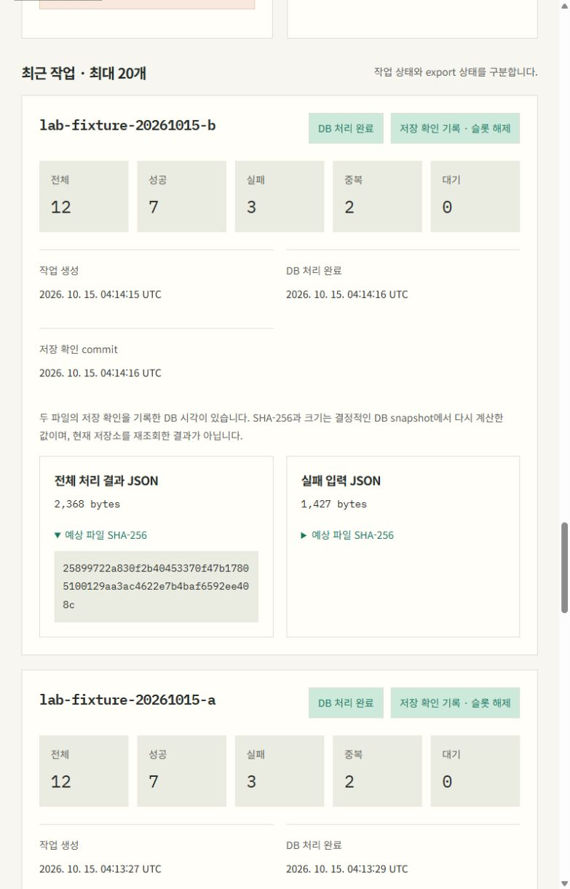

# 미니 PC 상시 worker/export와 공개 작업 관측

2026-10-15에 실제 K3s 배포와 공개 Pages 게시를 확인했습니다. [공개 작업 관측 화면](https://devdooly.github.io/devdooly-platform-lab/#job-observation), [허용 필드 근거](summary.json), [배포 결정](../../adr/0009-mini-pc-runtime-deployment.md)을 연결합니다. 회사 코드·데이터를 사용하지 않은 합성 예제입니다.

## 배포와 실제 실행

Jenkins #19와 [Actions 컨테이너 검증](https://github.com/DevDooly/devdooly-platform-lab/actions/runs/38679290578)이 동일 소스 `ed5815e7d72c6ea4f52456d902b7407c7a4a67b0`에서 성공했습니다. 실제 JUnit artifact는 19 suite·128개, 실패·오류·skip 0입니다. 웹 34개와 타입 검사·Pages 경로 빌드도 통과했습니다.

[이미지 게시 attempt 2](https://github.com/DevDooly/devdooly-platform-lab/actions/runs/38679550811/attempts/2)에서 gate·publish·GitOps PR 생성이 성공했습니다. 첫 attempt의 공개 메타데이터 HTTP 403은 게시 전에 차단됐고 재실행에서 정상 확인했습니다. gate를 우회하지 않았습니다. API/web의 익명 OCI 조회와 source 라벨·digest를 검증한 뒤 [PR #15](https://github.com/DevDooly/devdooly-platform-lab/pull/15)를 반영했습니다.

Kafka·Garage는 내부 Service와 전용 영속 PVC로 배포하고 실제 topic 리더/ISR·Garage layout·전용 bucket과 read/write key를 확인했습니다. API가 기존 V1을 보존하며 V2·V3를 각각 한 번 성공 적용한 후 [PR #16](https://github.com/DevDooly/devdooly-platform-lab/pull/16)에서 동일 API image의 worker를 활성화했습니다. 실제 여섯 컨테이너의 OCI index/manifest/config SHA·linux/amd64·CRI imageID 관계를 검증했습니다.

| 실제 확인 | 결과 |
| --- | --- |
| 실행기 | Kubernetes에서 실제 `--lab-runtime=run` 상시 CLI, RUNNING·최근 heartbeat |
| 등록 | 별도 내부 1회 Job의 `--lab-runtime=stage`, 고정 합성 입력만 허용 |
| 연속 처리 | `lab-fixture-20261015-a`, `lab-fixture-20261015-b` 순차 등록·완료 |
| 각 작업 결과 | 입력 12 = 성공 7 + 실패 3 + 중복 2 + 대기 0 |
| export | 두 작업 모두 EXPORTED, 결과·실패 파일 총 4개 |
| 별도 저장 확인 | S3 GET의 전체 bytes·크기·SHA-256이 예상 문서와 일치 |
| 실행 슬롯/outbox | 슬롯 비어 있음, DISPATCH·EXPORT 총 4개 ACKNOWLEDGED |
| Kafka | partition 0, committed offset 2 = log end 2, lag 0 |
| 배포 상태 | Argo Synced·Healthy, 여섯 워크로드 각각 1개 Ready |

각 결과 JSON은 2,368 bytes, 실패 JSON은 1,427 bytes였습니다. 실제 저장소 GET 재검증 시각은 `2026-10-15T04:14:44.968524Z`입니다. 문서별 SHA는 summary에 있습니다. 공개 UI의 SHA/크기는 DB에서 재계산한 기대 정보이고, 저장 확인 commit 시각을 보여줍니다. UI를 읽을 때마다 저장소를 GET하는 것은 아닙니다.

## 공개 게시와 자동 수집

- [실제 수동 수집·Pages 게시](https://github.com/DevDooly/devdooly-platform-lab/actions/runs/38680920814): capturedAt `2026-10-15T04:20:10.907960Z`
- [실제 systemd sandbox 실행·Pages 게시](https://github.com/DevDooly/devdooly-platform-lab/actions/runs/38681171418): capturedAt `2026-10-15T04:23:04.098313746Z`
- 두 회차 모두 build·deploy 성공과 공개 jobs/platform JSON 전체의 원본 일치를 확인했습니다. private 상태 파일은 root 0600이고 임시 SA token은 남지 않았습니다.
- 기존 timer는 `2026-10-15T04:24:10Z`에 enabled·active로 복구했습니다. 30분 주기와 최대 60초 random delay를 유지합니다. 새 job 코드의 다음 원래 주기 실행·반복 운영은 아직 별도로 관측하지 않았습니다. 과거 플랫폼 collector 11회 성공과 구분합니다.

실제 연결에서 Ubuntu Python 3.10이 Java Instant의 9자리 소수 초를 거부하는 문제를 발견했습니다. [PR #17](https://github.com/DevDooly/devdooly-platform-lab/pull/17)에서 엄격한 달력 검증과 나노초 정수 비교로 수정했고, 실제 Ubuntu에서 관측 테스트 135개·실패/skip 0을 확인했습니다. 위 systemd 회차는 9자리 원문 시각을 그대로 공개했습니다. 실패 중에도 기존 플랫폼 기록과 시각은 보존했고, 격리 시험 seed를 운영 기록으로 게시하지 않았습니다.

Pages는 실시간 API가 아니라 마지막 수집 기록입니다. heartbeat의 5분 경고는 30분 게시 간격 사이에도 나타나는 기록 나이이며 현재 실행기 생존을 판정하지 않습니다. 공개 POST·stage/resume·관리자 인증은 제공하지 않습니다.

공개 브라우저에서 작업 완료·파일 크기·SHA 펼치기와 기본 17px 본문, 가로 넘침 없음을 확인했습니다.

## 기존 환경 보존과 백업

배포 전후 26개 검사 모두 통과했습니다. 기존 Docker 38개/실행 26개의 ID·시작 시각·상태·mount, 원래 전체 PVC 3개의 UID/binding, DB Pod image·identity·mount·시작 시각을 보존했습니다. 기존 seed의 전체 SQL·처리 시각과 V1 migration 설치 행이 정확히 같습니다. 새 작업 행·V2/V3·전용 PVC 3개 추가는 의도한 변경이며, Lab namespace의 PVC는 총 4개 Bound입니다. host boot·Ready node·방화벽도 유지했습니다.

기존 MariaDB single-transaction dump·K3s SQLite online backup의 외부 암호화 사본을 배포 전에 확인했습니다. 배포 후에는 새 SQL dump·runtime 전용 비밀 설정 3개·검증한 export 문서 4개를 별도 AES-256-GCM 외부 사본으로 보관하고 인증·SHA read-back을 검증했습니다. 비밀값·실제 주소·원본 진단은 공개하지 않습니다.

## 확인하지 않은 범위

단일 미니 PC, Kafka 1 partition/RF1, Garage 복제 1 구성입니다. StatefulSet PVC Retain은 디스크 고장 대비 백업을 대신하지 않습니다. Kafka/Garage PVC 전체 복원, 여러 노드 장애 복구, 운영 Pod 종료·재개 장애 시험과 새 job timer의 장기 반복·자격증명 만료/회전은 후속입니다. 앞선 격리 중단 IT를 실제 운영 장애 시험으로 바꾸어 표기하지 않습니다.
