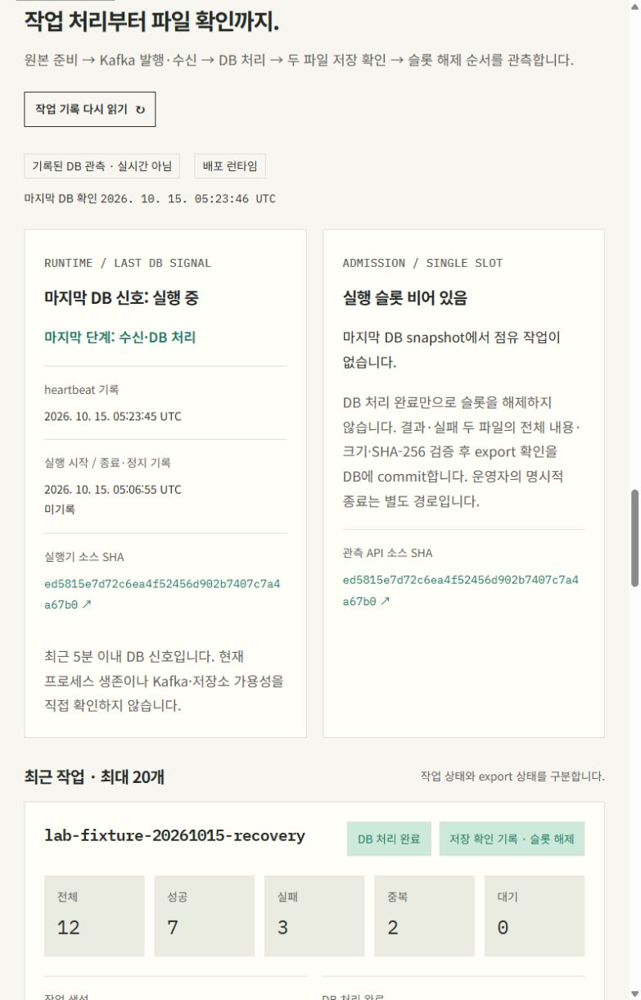

# worker 정상 재시작과 정기 관측 검증

2026-10-15 미니 PC의 실제 상시 worker를 정상 종료·교체하고 기존 처리 결과의 보존을 확인했습니다. [공개 작업 관측](https://devdooly.github.io/devdooly-platform-lab/#job-observation), [허용 필드 근거](summary.json), [이전 배포 근거](../runtime-deployment/README.md)에 연결합니다. 합성 데이터만 사용했습니다.

## 정상 재시작

실행 슬롯이 비고 기존 두 작업이 모두 EXPORTED인 상태에서 소유한 worker Pod 한 개를 UID 조건으로 삭제했습니다. 종료 유예 300초와 기존 배포 선언·image digest를 유지했고, 강제 종료·호스트 재부팅·다른 서비스 재시작은 실행하지 않았습니다.

| 실제 확인 | UTC 시각·결과 |
| --- | --- |
| 요청 | 2026-10-15 05:06:41.543654 |
| 기존 runtime STOPPED | 05:06:42.399059 |
| 새 runtime RUNNING | 05:06:55.482287 |
| 전체 검증 완료 | 05:06:59.352842, 요청부터 17.808초 |
| 종료·복귀 | 종료 marker <code>RUNTIME_EXIT STOPPED STOPPED NONE</code>, Java TERM exit 143, 새 Pod·container·Java 프로세스, restartCount 0 |
| 실행 신호 | 새 startedAt와 증가하는 heartbeat, 슬롯 비어 있음 |

종료 코드 143은 TERM을 받은 JVM의 정상 signal 종료일 수 있습니다. 실제 종료 marker·STOPPED journal·새 RUNNING의 순서와 container 종료를 함께 확인했습니다. [OpenJDK 21 TERM 처리](https://github.com/openjdk/jdk21u/blob/master/src/java.base/unix/classes/java/lang/Terminator.java)

Recreate 정책도 수동 Pod 삭제에서는 이전 Pod가 종료되는 동안 replacement가 만들어질 수 있습니다. 이번 실제 새 worker의 재시작 횟수는 0이었으며, 구현은 DB named lock으로 소유권을 제한합니다. 이것을 외부 I/O fencing이나 HA로 해석하지 않습니다. [Kubernetes Recreate](https://kubernetes.io/docs/concepts/workloads/controllers/deployment/#recreate-deployment)

## 보존 확인

재시작 전후 비교 23개를 모두 통과했습니다. 기존 두 작업과 seed의 전체 SQL 행·처리 시각, 원래 네 export 파일의 새 S3 GET 전체 bytes·크기·SHA-256이 일치했습니다. Kafka committed offset 2 = log end 2, lag 0을 유지했습니다.

API·web·DB·Kafka·Garage Pod의 identity·시작 시각·image·mount는 그대로였습니다. Docker 38개(실행 26개)의 ID·실행 상태·시작 시각·mount, 전체 PVC 6개(Lab 4개)의 UID·binding, host boot·방화벽·Ready node도 유지했습니다. private 원문·내부 주소·Pod UID·credentials는 Git에 포함하지 않습니다.

## 복구한 worker의 다음 작업

내부 stage 명령으로 lab-fixture-20261015-recovery 한 건을 추가했습니다. 복구한 같은 worker가 Kafka 발행·수신부터 DB 처리·두 파일 저장 확인·슬롯 해제까지 완료했습니다. 입력 12 = 성공 7 + 실패 3 + 중복 2 + 대기 0이며 capturedAt은 2026-10-15T05:12:17.039328367Z입니다.

세 작업 모두 EXPORTED, 파일은 총 6개입니다. 신규 결과·실패 파일 2개도 실제 S3 GET 전체 bytes·크기·SHA·JSON identity를 검증했습니다. Kafka offset 3 = log end 3, lag 0입니다. 새 작업의 행만 제외한 원래 전체 SQL은 재시작 전과 정확히 같았으며, 기존 두 작업의 HTTP 필드·시각·파일 정보도 유지됐습니다. 이후 다른 서비스·PVC·Docker·host 보존 최종 9개 검사도 통과했습니다.

## 자동 관측 게시

연속 두 자동 회차의 실제 timer trigger와 systemd invocation, 수집 시각, outbound dispatch run ID를 연결했습니다. 두 회차 모두 Pages build·deploy가 성공했고 각각 공개 jobs/platform JSON 전체가 서버 원본과 일치했습니다. 첫 공개 원본은 다음 게시로 교체되기 전에 비교 근거를 보관했습니다. [timer 비교 22개 통과](timer-proof.json), [게시·보존 결과](summary.json)에 연결합니다.

| 회차 | service 시작 UTC | job capturedAt | Pages |
| --- | --- | --- | --- |
| 1 | 2026-10-15 04:53:35.299889 | 04:53:37.320612517 | [38683858607 성공](https://github.com/DevDooly/devdooly-platform-lab/actions/runs/38683858607) |
| 2 | 2026-10-15 05:23:43.945259 | 05:23:46.301898317 | [38686554213 성공](https://github.com/DevDooly/devdooly-platform-lab/actions/runs/38686554213) |

기존 OnUnitInactiveSec=30min, 최대 60초 임의 지연, 60초 accuracy를 유지했습니다. 두 서비스의 실제 완료 간격은 1,809.371239초(30분 9.371초)였고 첫 inactive부터 다음 trigger까지 1,805.060428초였습니다. timer·service unit 두 파일과 설치 collector 여섯 파일의 SHA·수정 시각이 같았고 timer 활성 시각·invocation도 유지됐습니다. 중간 observer 수동 실행은 없었으며 임시 SA token도 남지 않았습니다.

첫 회차는 기존 두 작업과 이전 runtime 시작 시각을, 두 번째는 재시작한 runtime 시작 시각 05:06:55.482287Z와 새 작업을 포함한 세 EXPORTED 작업·파일 정보 6개·빈 슬롯을 게시했습니다. 원래 두 작업의 공개 필드 전체는 정확히 같았습니다. 두 번째 공개 원본 대조는 05:24:56 UTC에 완료했습니다. 이번 근거는 자동 회차 2개와 실제 간격 1개이며, 기존 플랫폼 collector의 과거 11회나 장기간 반복 운영으로 확대해 표기하지 않습니다.

## 검증 범위

이번 재시작은 완료된 두 작업 뒤의 유휴 상태에서 정상 TERM으로 수행했습니다. 처리·export 도중 강제 중단을 운영 Pod에서 검증한 결과가 아니며, 기존 격리 중단 시험은 [별도 근거](../continuous-runtime/README.md)로 유지합니다. 전체 Kafka/Garage PVC 복원·다중 노드 장애·장기간 운영·자격증명 만료와 회전은 후속입니다.

Pages는 마지막 수집 기록입니다. 30분 간격 사이에 보이는 heartbeat 5분 경고는 기록의 나이를 뜻하며 현재 프로세스 장애를 단정하지 않습니다. 공개 작업 제출·관리자 화면·token은 제공하지 않습니다.

